<h1 align="center">ELTS Research Software</h1>

  Run guided shooting-task sessions for the ELTS research study: fit and calibrate the participant, 
  teach the controls with a narrated walkthrough, run four timed scenarios with breaks, and review the data.

  
  
  

  <a href="#-install-and-run">Install and run</a> ·
  <a href="#-run-a-session">Run a session</a> ·
  <a href="#-the-participant-walkthrough">Participant walkthrough</a> ·
  <a href="#-review-and-export-data">Data</a> ·
  <a href="#-calibration-workspace">Calibration workspace</a> ·
  <a href="#-troubleshooting">Troubleshooting</a> ·
  <a href="#-project-status">Status</a> ·
  <a href="#-developer-setup">Developer setup</a>

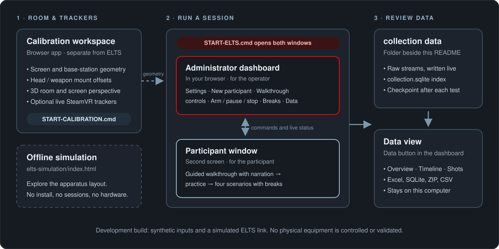

> [!IMPORTANT]
> This is a **development build**. It runs on synthetic (mouse and keyboard) inputs and a simulated ELTS link. It does not control or validate any physical equipment. Calibration here is a software exercise, not physical calibration. Follow the [safety boundaries](docs/safety/README.md) and the [hardware validation checklist](docs/operator/hardware-follow-up.md) before any physical use.

---

<table>
<tr>
<th width="50%">🧑‍🔬 I run study sessions</th>
<th width="50%">👩‍💻 I change the software</th>
</tr>
<tr>
<td>Download a ZIP, double-click one file and use the dashboard. No Git, no coding, no Unity Editor window.  <b>→ <a href="#-install-and-run">Install and run</a></b></td>
<td>Clone with Git, open the Unity project, run the checks and push changes between computers.  <b>→ <a href="#-developer-setup">Developer setup</a></b></td>
</tr>
</table>

---

## 🚀 Install and run

### Run the packaged rehearsal

The prebuilt package runs on Windows x64 without the Unity Editor or developer tools. [Download the Windows rehearsal ZIP](https://github.com/AceeEcho/DESS-ELTS-Research-Software/releases/download/development-rehearsal-2026-11-18/ELTS-Development-Rehearsal-20261118.zip).

1. Extract the full ZIP, then double-click **PREPARE-REHEARSAL.cmd** to create fictional participant **0** and open ELTS.
2. In the dashboard choose **New participant**, select **0**, and choose **Create recording**.
3. Use **ADD-REHEARSAL-ID.cmd** to pick another fictional ID. If ELTS is open, the ID appears in its picker. Use **START-ELTS.cmd** to reopen the same rehearsal on later visits.

The package stores its collection under `%LOCALAPPDATA%/ELTS/DevelopmentRehearsal` by default. A regular launch after permanent removal opens an empty dataset. To update the app, extract the new release into a new folder and use **START-ELTS.cmd** there. The rehearsal collection carries over.

### Install from source

Use the source checkout for the separate calibration workspace or to change the software. Developers can follow [Developer setup](#-developer-setup).

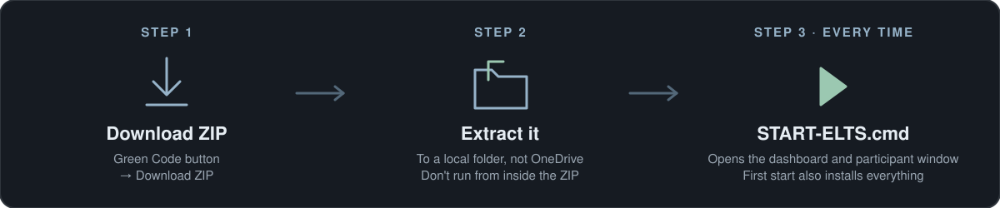

You do **not** need Git, GitHub Desktop or any coding. You do need internet access and permission to install software the first time.

<b>Step 1 · Download the ZIP</b>

At the top of [this GitHub page](https://github.com/AceeEcho/DESS-ELTS-Research-Software), leave the branch on **main**, click the green **Code** button, then click **Download ZIP**.

| Click **Code** | Then **Download ZIP** |
| :---: | :---: |
| 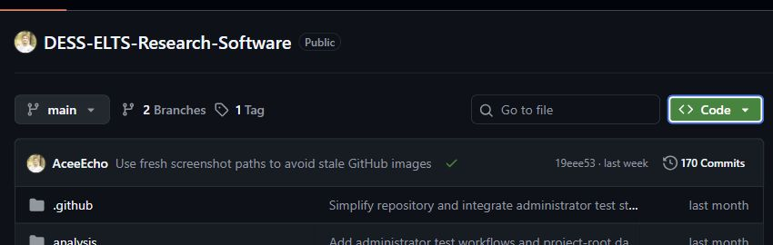 | 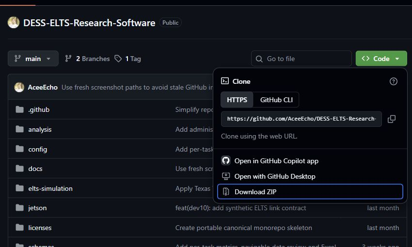 |

**Step 2 · Extract it.** Right-click **DESS-ELTS-Research-Software-main.zip** → **Extract All…**. Choose a normal local folder such as `C:\Users\YOUR-NAME\ELTS`, **not** OneDrive, Dropbox or another synced folder. Open the extracted folder and find **START-ELTS.cmd**. Always run it from this folder, never from inside the ZIP. Files marked **(Dev Only)** are for developers; you can ignore them.

**Step 3 · Double-click START-ELTS.cmd.** It opens the **administrator dashboard** in your browser and the **participant window** as a separate app. The **first start** on a computer also sets everything up: ELTS is built on your computer, so it installs Unity **6000.3.23f1 LTS** and the other tools, checks them and builds the app. That takes a while, so leave the window open. Accept Windows install prompts and sign in to Unity Hub if asked; if it stops for licensing, activate in Unity Hub and double-click **START-ELTS.cmd** again. A small startup window shows progress and closes on its own; if something fails it stays open with an **Open startup log** button.

> [!TIP]
> From now on, just double-click **START-ELTS.cmd**. Keep the whole extracted folder together. Source launches save recordings in **collection data** by default. If a step fails, see [setup troubleshooting](docs/operator/troubleshooting.md#install-and-startup).

**Tracking PC (optional).** To set up the room, screen and Vive trackers, double-click **START-CALIBRATION.cmd**. The first time, it offers to install the live-tracking tools (answer **Y**); manual preview works without them. This needs no Unity. See [Calibration workspace](#-calibration-workspace).

**VIVE gun trigger (optional).** The gun tracker's trigger can fire in tutorial practice, start a scenario and fire scored shots. To turn it on:

1. In SteamVR **Manage Trackers**, set the gun tracker to **Held in hand → Right Hand** (or Left Hand).
2. In the calibration workspace, pick that tracker under **Weapon**, check that the trigger indicator above the 3D view shows **pressed** and **released**, then open **Save calibration** and choose **Save station room**.
3. Double-click **START-ELTS.cmd**. It uses the tracker binding from the saved station room.

Aiming still uses the desktop/synthetic pose source; the mouse keeps working. Details: [trigger setup](docs/developer/modules/vive-trigger.md).

**Updating a source installation.** With both apps closed, copy the station data to a stable folder and set `ELTS_STATION_HOME` for both launchers. Use that folder with the new source ZIP. [Move a station or restore a copy](docs/operator/user-guide.md#move-a-station-or-restore-a-copy)

### Source checkout launchers

| File | When to use it |
| --- | --- |
| **START-ELTS.cmd** | Every session. Opens the dashboard and the participant window (and sets the computer up the first time). |
| **START-CALIBRATION.cmd** | To set up the room, screen and trackers in the separate [calibration workspace](#-calibration-workspace). |

Everything marked **(Dev Only)** is for [developers](#-developer-setup).

---

## 🧭 Run a session

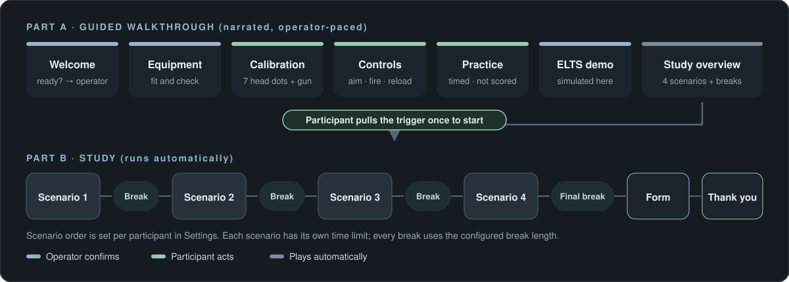

> **Quick flow:** Open → ⚙ Settings → New participant → Begin walkthrough → participant pulls the trigger once → scenarios and breaks run automatically → form.

### 1 · Open the software

Double-click **START-ELTS.cmd** after installation. On the first packaged rehearsal, start with **PREPARE-REHEARSAL.cmd**. You control the session from the dashboard. The participant sees the separate participant window.

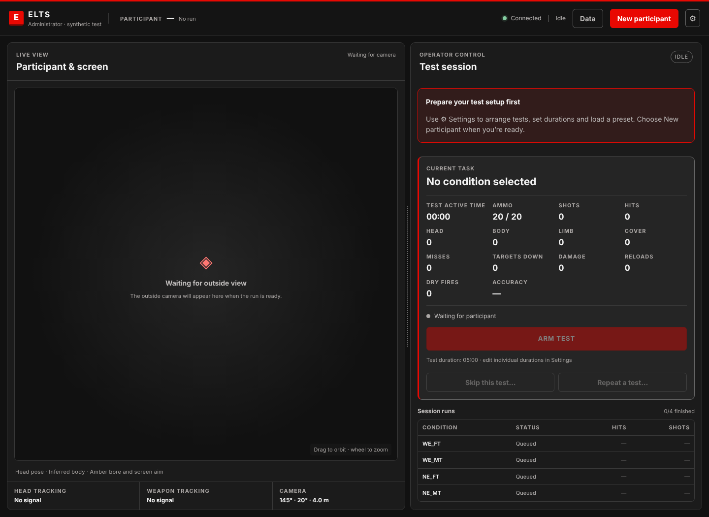

| Where | What it does |
| --- | --- |
| **⚙ Settings** (top right) | Scenario order, time limits, practice and break lengths, window options |
| **New participant** (top right) | Choose a saved participant ID and start a recording |
| **Test session** (right pane) | Walkthrough controls, arm / pause / resume / stop, breaks and save status |
| **Outside view** (left pane) | Camera view. Drag to orbit, scroll to zoom |
| **Data** (top right) | Participant profiles, saved sessions and exports |

Drag the thin divider to resize the panes. Gray buttons light up when their action is allowed.

### 2 · Set the order and times

Open **Review setup** or **⚙ Settings** before creating a participant.

| Scenario order | Durations |
| :---: | :---: |
| 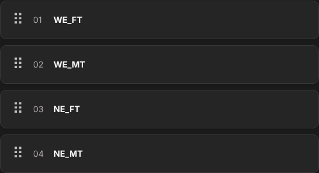 | 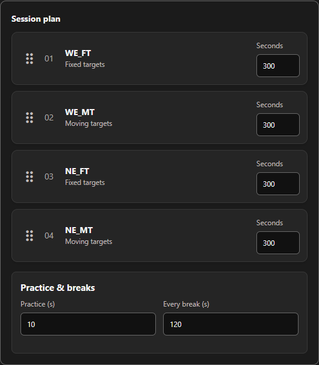 |
| Drag the **six-dot handle** (or focus it and use ↑/↓). Escape cancels. Order locks once a session starts. | Enter seconds per scenario (default **300**), click outside to save. Practice and break times save the same way. |

> [!NOTE]
> The study plan calls for two-minute breaks: set **Every break** to **120** seconds. The walkthrough never changes your settings on its own.

To reuse a setup, type a **Preset name** under **Saved setups** → **Save setup**; later choose it → **Load**. Presets are stored in that browser.

### 3 · Create the participant recording

Click **New participant**, choose a saved **Participant ID**, then click **Create recording**. In the Windows package, use **ADD-REHEARSAL-ID.cmd** to create another fictional ID. From source, use **START-CALIBRATION.cmd** to save the calibration under a numeric ID. The same ID groups that participant’s visits.

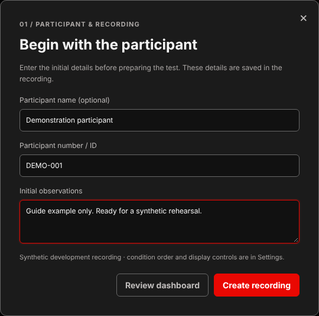

### 4 · Begin the walkthrough

Click **Begin walkthrough**. The participant window guides the participant step by step ([see every screen below](#-the-participant-walkthrough)) while the dashboard tells you what to do next.

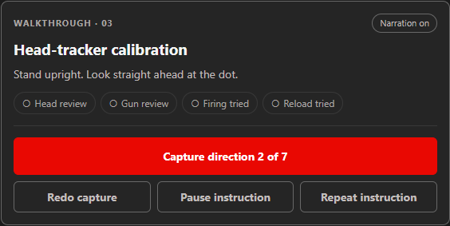

- **The big red button is always your next action**, for example *Participant is ready*, *Capture direction 2 of 7*, *Start practice* or *Confirm form completed*. It stays disabled until the current narration finishes.
- **Pause instruction** / **Repeat instruction** pause or replay the current narration and picture. Repeating never re-captures, re-fires or restarts anything.
- **Redo capture** discards the head directions and starts them again.
- During practice: **Pause practice**, **Restart practice**, **Finish practice**.
- The checklist updates when the corresponding steps finish. **Settings** also offers narration captions and a display and audio check.

 

### 5 · Run the scenarios

After the overview the first scenario arms by itself. The participant sees **Shoot to begin** and pulls the trigger once; that start shot is not scored. From then on, scenarios and breaks follow each other automatically: each scenario saves, a break counts down, and the next scenario starts when tracking is valid. After the final break the participant fills in the post-study form, you click **Confirm form completed**, and the thank-you screen appears.

<b>Running a session without the walkthrough (manual mode)</b>

 

Instead of **Begin walkthrough**, click **Manual mode · skip walkthrough** and confirm. The synthetic calibration fixture is saved automatically, practice is skipped, and the first test waits for you. Nothing arms, starts a break or starts a test on its own in manual mode. The choice can't be undone for that participant.

Check the condition and duration in **Current task**, then click **ARM TEST** when the participant is ready. **DISARM TEST** cancels before they start.

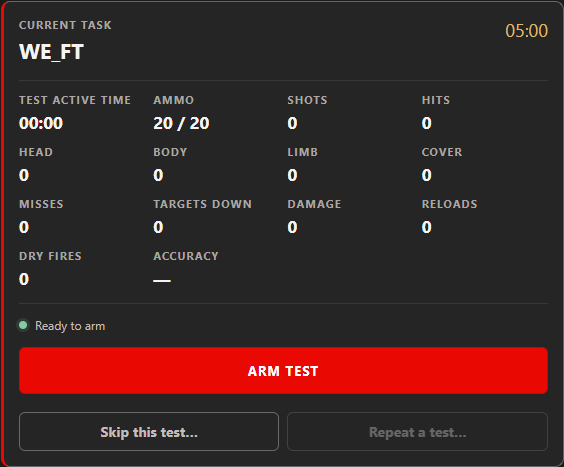

After each test: wait for saving, click **Start break** (waiting beforehand uses no break time), let it count down or click **Skip break**, then **ARM TEST** for the next one.

| Waiting to start the break | Break counting down |
| :---: | :---: |
| 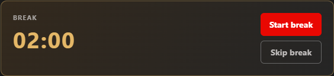 | 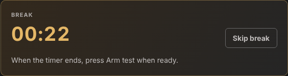 |

After the final test, complete or skip its break to close the recording, then click **Confirm form completed** once the participant has filled in the post-study form.

### 6 · Pause, stop or finish a session

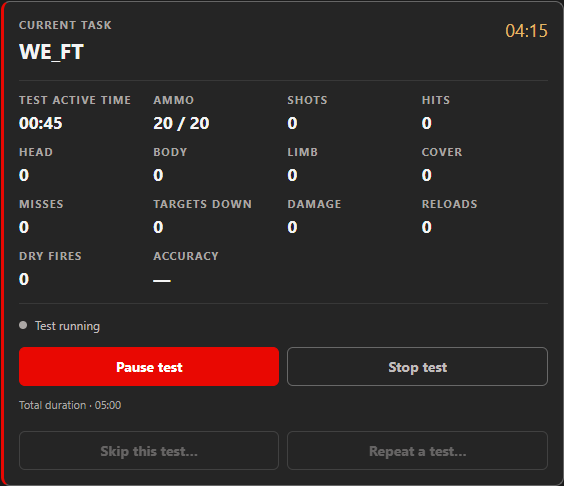

| Button | What happens |
| --- | --- |
| **Pause test** / **Resume test** | Freezes the timer and targets, then continues the same attempt |
| **Stop test** | Ends early after a confirmation. Saved as **Stopped early**; it cannot resume |
| **Skip this test…** | Skips a ready, unarmed scenario with a reason |
| **Repeat a test…** | Adds another attempt with a reason; earlier results are kept |
| **Skip break** | Ends the current break early |
| **Abort participant session** | Opens a confirmation. Confirming ends the session and closes the recording. |

### Participant controls (desktop rehearsal)

| Action | Input |
| --- | --- |
| Aim | Move the mouse |
| Fire one round | Click and release |
| Reload (20-round magazine, never automatic) | **R** |
| Move forward / back · left / right · down / up | **W / S** · **A / D** · **Q / E** |
| Reset the virtual pose | **Home** |
| Fullscreen on / off | **F11** or **Alt + Enter**, **Esc** to restore |

Targets have three health points: head, body and limb hits deal 3, 2 and 1 damage. Switching windows does **not** pause the timer. See [desktop input](docs/developer/modules/desktop-input.md) for details.

---

## 🎓 The participant walkthrough

A narrated, step-by-step tutorial on the participant window replaces the old instructional video. It is built for someone who has never seen the study: **one picture and one instruction per screen**, a progress bar across the top, and a badge that always says what to do right now.

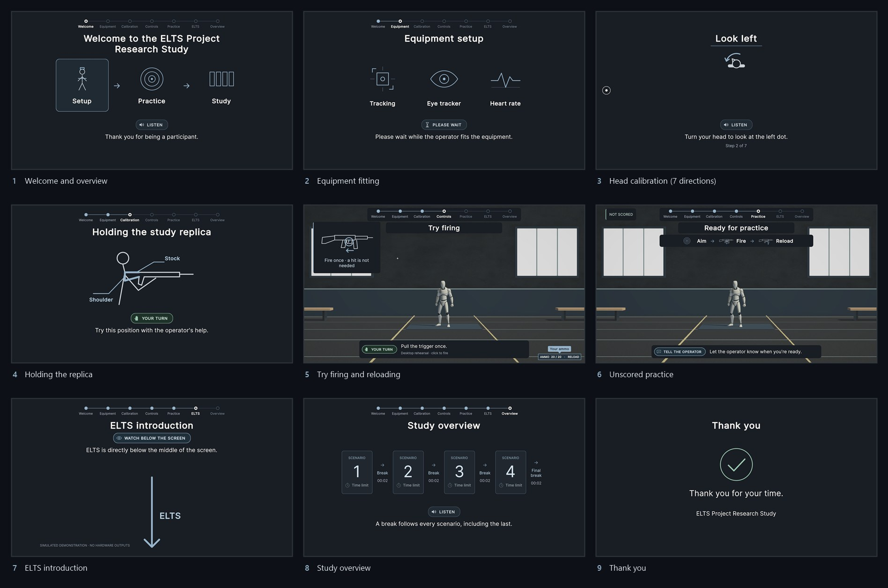

**What the badge means**

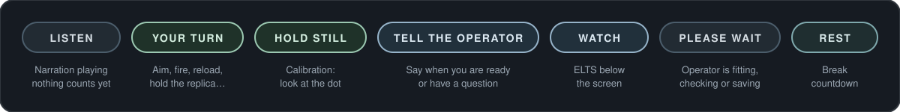

The badge says **Listen** until the narration ends. Shots, reloads and captures only count after that, so an early trigger pull is simply ignored.

**Calibration steps.** Each head direction shows a simple picture from above with a turning or stepping arrow, and a single ringed dot to look at. The operator captures each direction, then reviews and accepts it.

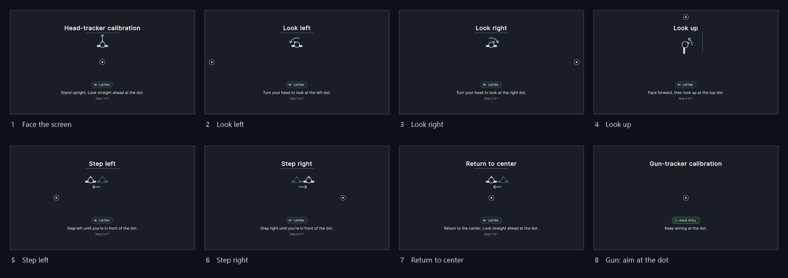

| Part | What the participant does | What you do |
| --- | --- | --- |
| Welcome | Listens; says when ready | **Participant is ready** |
| Equipment | Gets fitted; mentions any discomfort | **Equipment fitting finished**, then **Equipment checked** |
| Calibration | Looks at 7 dots, tries the holding position, aims at the gun dot | Capture each direction and accept the review; **Holding position tried · comfortable**; capture and accept the gun step |
| Controls | Aims, fires once, reloads once (a hit is not needed) | **Aiming tried and understood**; firing and reloading are detected automatically |
| Practice | Practises freely; not scored | **Start practice** (the timer starts after the instructions), then **Ready for the simulated ELTS demonstration** |
| ELTS demo | Looks below the screen, then asks any questions | One **simulated** demonstration runs (no hardware outputs); then **Questions answered · continue** |
| Overview | Learns about 4 scenarios, time limits and breaks | Nothing; it leads straight into the study |

> [!NOTE]
> All 39 narration clips are recorded and bundled. The wording lives in the [tutorial script](docs/participant-tutorial/script.md) (a plain [reading copy](docs/participant-tutorial/reading-script.md) is generated from it). Visual settings such as dot positions are in `ParticipantTutorialSettings.json`. Full details: [walkthrough guide](docs/developer/modules/participant-tutorial.md).

---

## 📊 Review and export data

Click **Data** at the top of the dashboard. Click **Test administration** to go back; switching views never pauses a running test.

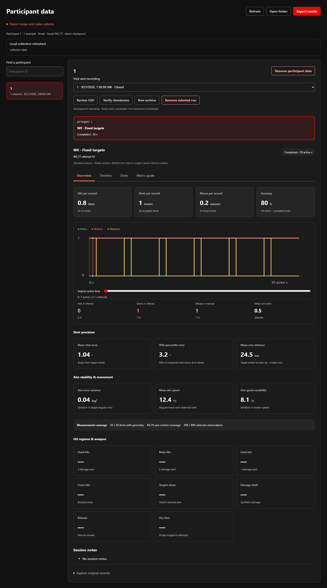

1. **Find the participant** by ID. Reusing an ID groups all their visits under one profile.
2. **Choose a visit and recording**, then an attempt. Use **Overview**, **Timeline**, **Shots**, or **Metric guide**.
3. **Refresh** picks up changed recordings. **Verify checksums** checks a closed recording against its saved closure summary. Expand **Standard 300-second analysis** to see the eligibility screening and any exclusion reason.

| Timeline: drag across the graph | Shots: filter hits, misses, unknown |
| :---: | :---: |
| 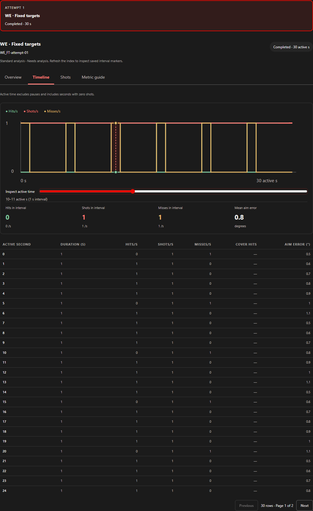 | 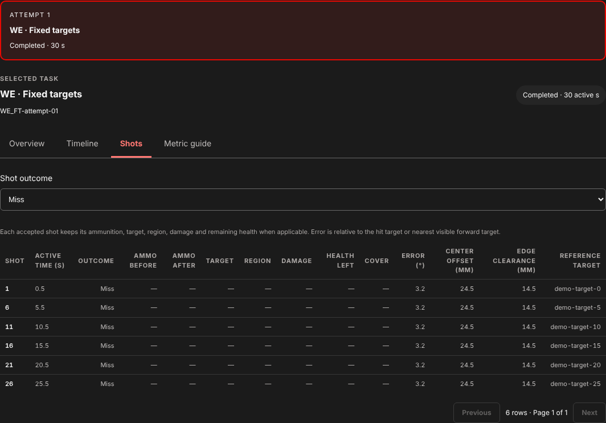 |

A **—** means a value is unavailable, not zero. Active time excludes pauses.

| Export | What you get |
| --- | --- |
| **Export results** | Creates an Excel workbook for everyone, one participant, one visit or a UTC recording modification date range. Includes **Results**, **Shots**, **Timeline**, **Metric guide**, a **Recordings** manifest, and **Handoff** rows for matching external recordings. Preview the row counts under **Export scope and index options**. |
| **Raw archive** | A ZIP of one closed recording’s original tracker, target and event files with their checksums |
| **Recovery copy** | Available files from an interrupted recording after acquisition stops |

Click **Download export** to save a prepared export; copies also stay in the data folder's **exports** directory. **Open folder** shows the data folder itself.

Wait for saving to finish before closing ELTS. Participant data is stored locally and excluded from Git. [Move or restore a collection](docs/operator/user-guide.md#move-a-station-or-restore-a-copy)

### Start a fresh dataset

Finish or abort the active session. Go to the bottom of **Settings** and click the red **Remove all participant data…** button. Type `CONFIRM` exactly and click **Remove** to erase the station’s participant recordings, calibrations, drafts, index, and managed exports. This operation creates no backup. Shared room settings and copies stored elsewhere are separate. [Full reset steps](docs/operator/user-guide.md#start-a-fresh-dataset)

---

## 🎯 Calibration workspace

A separate browser app for setting the display and previewing the participant’s view. Save shared room settings separately from numeric participant calibrations. It never starts ELTS and its profiles are stored apart from ELTS recordings.

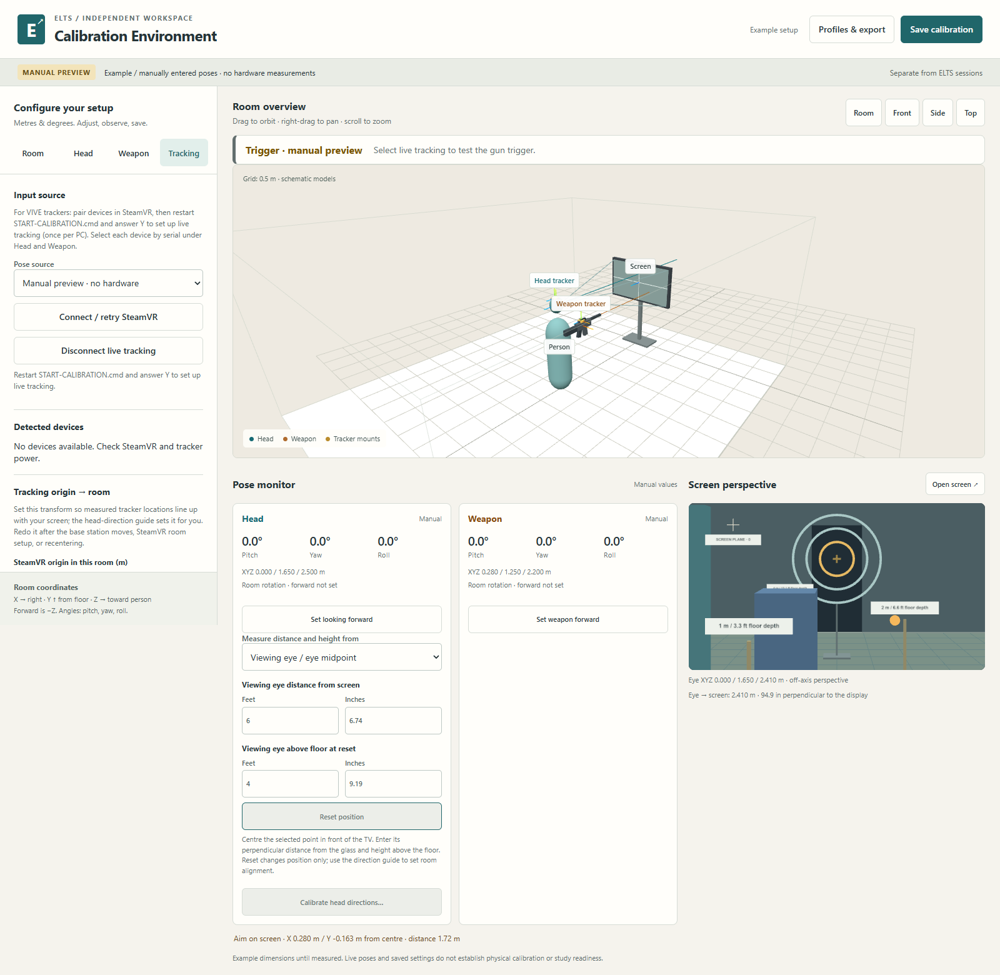

1. Double-click **START-CALIBRATION.cmd**. **Manual preview** works with no equipment.
2. For live Vive trackers, answer **Y** when it offers the one-time setup on a new PC. It installs Python, the OpenVR reader, Steam and SteamVR, and configures headset-free tracking with backups of your existing settings. Live mode then reads the SteamVR trackers.

See the [calibration workspace guide](Calibration%20Environment/README.md). Example values are not measurements; software checks do not establish physical calibration.

## 🧩 Offline apparatus simulation

Open [elts-simulation/index.html](elts-simulation/index.html) from your downloaded folder in any browser. Orbit the scene, choose a condition, move the participant, change the display width and use **Explore equipment** to find each component. No install or server; it doesn't run sessions or touch hardware. [Simulation guide](elts-simulation/README.md).

---

## 🛠 Troubleshooting

| What you see | What to do |
| --- | --- |
| **Offline** at the top of the dashboard | Make sure the participant window is still open, then refresh the browser |
| The big walkthrough button is gray | Let the narration finish; then complete the step it names |
| **ARM TEST** is disabled | Finish the walkthrough/practice or break and wait for saving |
| Scenario order won't change | It locks during a session; change it before the next participant |
| A save fails or a recording looks incomplete | Read the message and keep the files; don't treat it as finalized |
| Startup stops with an error | Read the startup window, then [setup troubleshooting](docs/operator/troubleshooting.md#install-and-startup) |
| A device, export or analysis step fails mid-session | [Session troubleshooting](docs/operator/troubleshooting.md) |

Full reference: [administrator dashboard](docs/developer/modules/operator-dashboard.md).

---

## 📌 Project status

| Area | Status |
| --- | --- |
| Interactive participant walkthrough with recorded narration | ✅ In the development build |
| Practice room (separate, unscored, timed) | ✅ In the development build |
| Procedure briefing and automatic scenario → break → form flow | ✅ In the development build |
| ELTS introduction and demonstration | 🟡 Simulated only; real apparatus not connected |
| ELTS integration and synchronization | 🟡 Protocol fixture and [simulated controller](docs/developer/modules/elts-link.md#controller-jetson-boundary) only; needs the controller's wire contract |
| Physical participant controller (mock replica input) | 🟡 The gun tracker's trigger is read in software ([trigger setup](docs/developer/modules/vive-trigger.md)). The mock rifle is an airsoft platform with a printed pogo-pin tracker cradle ([connector designs](hardware/README.md)); its rail mount is in progress. Aiming from the gun tracker's pose is not connected yet |
| Heart-rate, eye-tracker and NASA-TLX data alignment | ⬜ Not started |
| Room survey: screen size and 5 / 6 / 7 ft floor marks | ✅ Screen size recorded (Samsung QB65R-B, the default in ELTS and the calibration workspace) and floor marks placed ([survey](docs/operator/hardware-follow-up.md#current-inventory-and-starter-room-survey)) |

**Current tracking hardware** (confirmed October 21, 2026): one base station, two Vive trackers, existing tracker mounting posts and a headband with mounts. Having the equipment does not establish calibration, tracking coverage, mount rigidity, safety or study readiness.

---

## 👩‍💻 Developer setup

*For people who change the code, the tutorial content or the docs. To run sessions only, use [Install and run](#-install-and-run).*

| | Operator | Developer |
| --- | :---: | :---: |
| Gets the code by | Download ZIP | **Cloning with Git** (GitHub Desktop or `git`) |
| Runs `START-ELTS.cmd` | ✅ | ✅ |
| Uses the **(Dev Only)** launchers | — | ✅ |
| Opens the Unity project in the Editor | — | ✅ |
| Runs checks before committing | — | ✅ |
| Pushes and pulls between computers | — | ✅ |

### 1 · Clone the repository

You need a GitHub account with access to this repository. In [GitHub Desktop](https://desktop.github.com/), choose **File → Clone repository → URL**, enter `https://github.com/AceeEcho/DESS-ELTS-Research-Software.git`, and pick a **non-synced** local folder such as `C:\Users\YOUR-NAME\source\DESS-ELTS-Research-Software`. Never keep a working copy in OneDrive or Dropbox: Unity's caches and Git do not mix with folder sync.

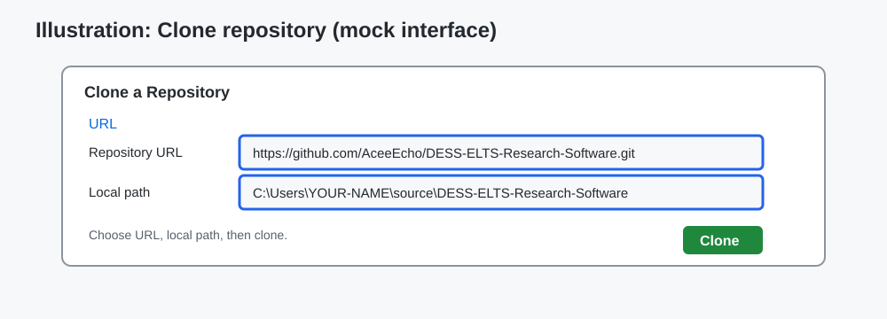

Command-line alternative: `git clone https://github.com/AceeEcho/DESS-ELTS-Research-Software.git`

### 2 · Run SETUP-DEV (Dev Only).cmd

Setup without launching the app. It finds or installs pinned Python, .NET SDK, Node.js, Unity Hub and Unity **6000.3.23f1 LTS** (official, checksum-verified downloads), creates your local config, imports the Unity project and runs full verification. Close Unity first. Logs go to `diagnostics/setup-report.json` and `diagnostics/setup-console.log`. Run it again only when the toolchain changes, not after every edit.

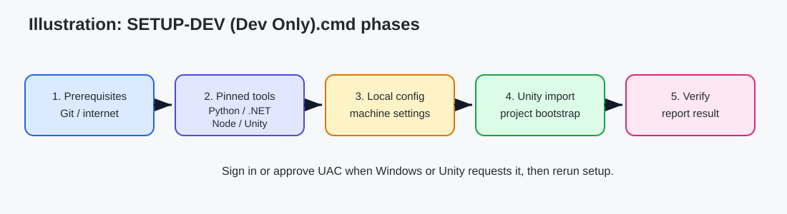

### 3 · Open the project and run the app

- **Unity Editor:** in Unity Hub choose **Add / Open existing project** and select the `unity/` folder. Use exactly **6000.3.23f1**; if Hub offers another version, stop and install the pinned one.
- **Run the app:** `START-ELTS.cmd` builds (or reuses an unchanged build) and launches it. **Close the Unity project first** when a rebuild is needed. Builds go to `build/start-elts-*`; the log is `diagnostics/start-console.log`.
- **Dev shell:** `OPEN-DEV-SHELL (Dev Only).cmd` opens PowerShell with the detected tool paths, without changing your system `PATH`.
- **Readiness report:** `CHECK-SYSTEM (Dev Only).cmd` checks tools, staging and versions (software only, never physical acceptance).

### 4 · Daily loop

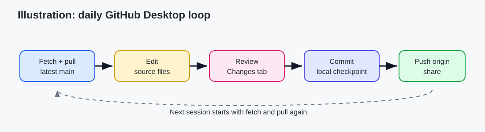

Close Unity → **Pull** → edit → run checks → review every changed file → **Commit** → **Push**. There is no automatic sync: finish and push on one computer before pulling on another. Full illustrated guide: [setup on more than one computer](docs/operator/multi-machine-setup.md).

### Checks

| Command | What it covers |
| --- | --- |
| `python tools/ci/check.py --baseline` | Portable checks: paths, Unity `.meta` files, doc links, tutorial script sync, Python unit tests (Python 3.10+) |
| `scripts/test.ps1 -Suite <name>` | One suite: `baseline`, `validation`, `config`, `geometry`, `runtime`, `unity-edit`, `unity-play` |
| `scripts/verify.ps1` | Full development verification, including the available Unity and runtime tests |
| `dotnet run --project tools/runtime-tests/TutorialChecks.csproj` | Walkthrough progression rules (fast, no Unity) |

`scripts/test.ps1` runs Unity tests with `-noaudio`; add it yourself when running them from the command line. Set `ELTS_TUTORIAL_CAPTURE_DIR` while running `ParticipantTutorialTests` to save a screenshot of every walkthrough screen.

### Common tasks

| Task | How |
| --- | --- |
| Change tutorial narration or on-screen steps | Edit [the tutorial script](docs/participant-tutorial/script.md), then `py -3 tools/build/export_participant_tutorial.py` (add `--check` to verify). Recordings follow the [audio workflow](docs/participant-tutorial/audio-workflow.md) |
| Change tutorial visuals | `unity/Assets/ELTS/Operator/ParticipantTutorial*.cs` and `Resources/ELTS/ParticipantTutorial.uss/.uxml/Settings.json` ([walkthrough guide](docs/developer/modules/participant-tutorial.md)) |
| Rebuild the offline simulation | `node elts-simulation/build.mjs` from the dev shell |
| Build a standalone player | `scripts/build.ps1 -Output build/<new-empty-folder>` ([build provenance](docs/developer/modules/windows-build.md)) |
| Refresh the dashboard screenshots | `node tools/browser-tests/capture-user-guide.cjs` (needs Playwright and Chrome) |
| Look up an ID such as D-12, DEV-10 or P8.4 | [Decision and work-item IDs](docs/decisions.md) |

Local, machine-specific settings live in `config/local.json` and `config/local/` and are never committed. Research recordings stay out of Git. `scripts/setup-study-machine.ps1` and `scripts/start-study.ps1` are the future study entry points; they deliberately refuse to run until study configuration, physical acceptance and release approval exist. A root study launcher will be added with an approved release.

### Where things are

| Folder | Contents |
| --- | --- |
| `unity/` | Unity app: tracking, calibration, sessions, walkthrough, rendering, logging and the dashboard |
| `Calibration Environment/` | [Standalone room and tracker setup](Calibration%20Environment/README.md) |
| `elts-simulation/` | [Offline browser simulation](elts-simulation/README.md) |
| `analysis/` | [Run ingestion and analysis](docs/developer/modules/analysis.md) |
| `config/`, `schemas/` | Editable settings and data contracts |
| `scripts/` | The PowerShell commands you run: setup, start, build, test, verify |
| `tools/` | The Python and C# code behind those commands, plus the runtime test projects |
| `hardware/` | [Tracker trigger connector CAD and bench tests](hardware/README.md) |
| `docs/` | [Documentation map](docs/README.md): operator guides, developer and module docs, the participant tutorial, safety |
| `collection data/` | Your local recordings and exports (created on first run, never committed) |
