<h1 align="center">ELTS Research Software</h1>

<p align="center">
  Run guided shooting-task sessions for the ELTS research study: fit and calibrate the participant,<br>
  teach the controls with a narrated walkthrough, run four timed scenarios with breaks, and review the data.
</p>

<p align="center">
  
  
  
</p>

<p align="center">
  <a href="#-quick-start">Quick start</a> ·
  <a href="#-run-a-session">Run a session</a> ·
  <a href="#-the-participant-walkthrough">Participant walkthrough</a> ·
  <a href="#-review-and-export-data">Data</a> ·
  <a href="#-calibration-workspace">Calibration workspace</a> ·
  <a href="#-troubleshooting">Troubleshooting</a> ·
  <a href="#-project-status">Status</a> ·
  <a href="#-for-developers">Developers</a>
</p>

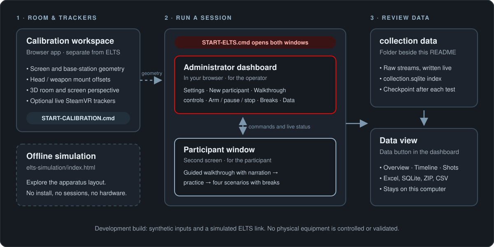

> [!IMPORTANT]
> This is a **development build**. It runs on synthetic (mouse and keyboard) inputs and a simulated ELTS link. It does not control or validate any physical equipment. Calibration here is a software exercise, not physical calibration. Follow the [safety boundaries](docs/safety/README.md) and the [hardware validation checklist](docs/operator/hardware-follow-up.md) before any physical use.

---

## 🚀 Quick start

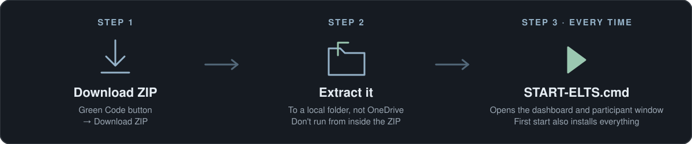

You do **not** need Git or GitHub Desktop. Setup installs anything that is missing.

<details open>
<summary><b>Step 1 · Download the ZIP</b></summary>

At the top of [this GitHub page](https://github.com/AceeEcho/DESS-ELTS-Research-Software), leave the branch on **main**, click the green **Code** button, then click **Download ZIP**.

| Click **Code** | Then **Download ZIP** |
| :---: | :---: |
| 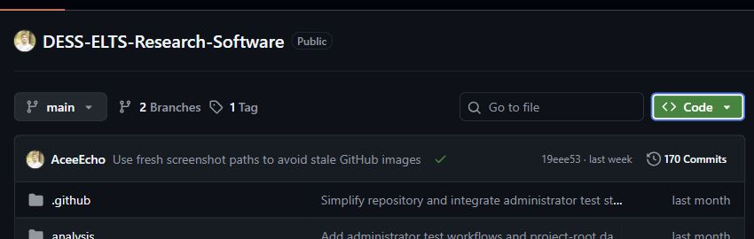 | 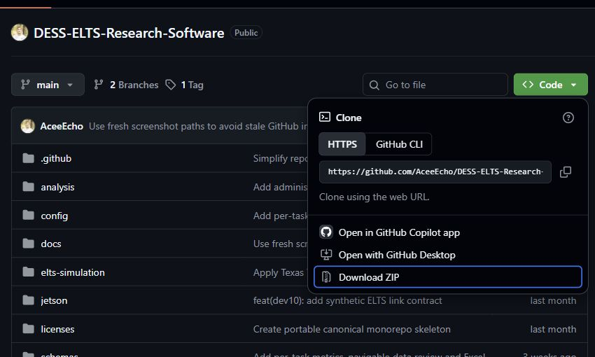 |

</details>

**Step 2 · Extract it.** In **Downloads**, right-click **DESS-ELTS-Research-Software-main.zip** → **Extract All…** → **Extract**. Open the extracted folder; you should see **SETUP-DEV.cmd** and **START-ELTS.cmd**. Always run them from this folder, never from inside the ZIP.

**Step 3 · Run SETUP-DEV.cmd once.** Leave the window open until it reports success. The first run downloads tools, imports Unity **6000.3.23f1 LTS** and checks the software, so give it time. Accept any Windows install prompts and sign in to Unity Hub if asked; if it stops for licensing, activate in Unity Hub and run it again.

**Step 4 · Run START-ELTS.cmd.** This opens the **administrator dashboard** in your browser and the **participant window** as a separate app. The first launch builds the application, which can take several minutes. A small startup window shows progress and closes on its own; if something fails it stays open with an **Open startup log** button.

> [!TIP]
> From now on, just double-click **START-ELTS.cmd**. Keep the whole extracted folder together. If a step fails, see [setup troubleshooting](docs/operator/multi-machine-setup.md#if-something-goes-wrong). To work across several computers with GitHub Desktop, see the [full setup guide](docs/operator/multi-machine-setup.md).

### Which file do I double-click?

| File | When to use it |
| --- | --- |
| **START-ELTS.cmd** | Every session. Opens the dashboard and the participant window. |
| **SETUP-DEV.cmd** | Once per computer, or again after a failed setup. Installs and checks everything without opening the app. |
| **SETUP-TRACKING.cmd** | Once on a tracking PC. Installs the Python/OpenVR tracking tools and Steam/SteamVR (no Unity or Git needed). |
| **START-CALIBRATION.cmd** | To set up the room, screen and trackers in the separate [calibration workspace](#-calibration-workspace). |
| **CHECK-SYSTEM.cmd** | To print a readiness report for this computer (software only, never physical acceptance). |
| **OPEN-DEV-SHELL.cmd** | Developers: a PowerShell window with the detected tool paths. |

---

## 🧭 Run a session

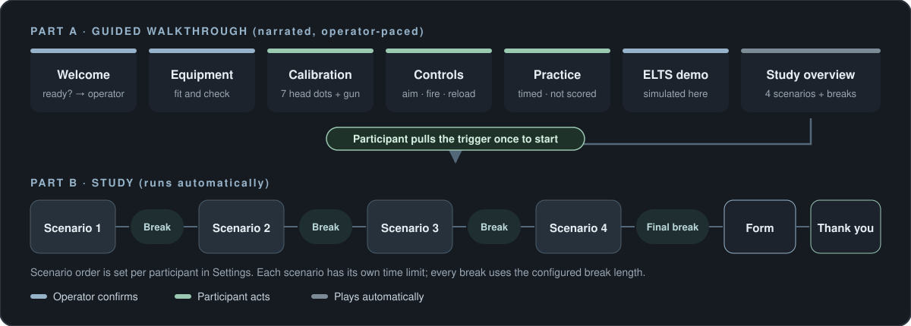

> **Quick flow:** Open → ⚙ Settings → New participant → Begin walkthrough → participant pulls the trigger once → scenarios and breaks run automatically → form.

### 1 · Open the software

Double-click **START-ELTS.cmd**. You control everything from the dashboard; the participant only sees the participant window.

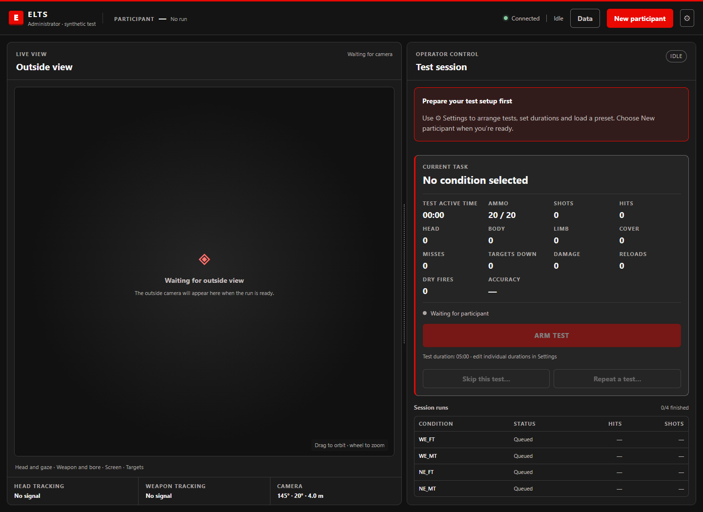

| Where | What it does |
| --- | --- |
| **⚙ Settings** (top right) | Scenario order, time limits, practice and break lengths, window options |
| **New participant** (top right) | Enter participant details and start a recording |
| **Test session** (right pane) | Walkthrough controls, arm / pause / resume / stop, breaks, notes and save status |
| **Outside view** (left pane) | Camera view. Drag to orbit, scroll to zoom |
| **Data** (top right) | Participant profiles, saved sessions and exports |

Drag the thin divider to resize the panes. Gray buttons light up when their action is allowed.

### 2 · Set the order and times

Open **⚙ Settings** before creating a participant.

| Scenario order | Durations |
| :---: | :---: |
| 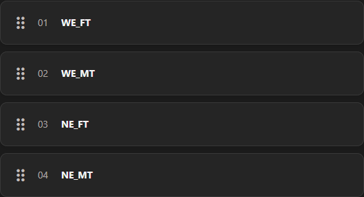 | 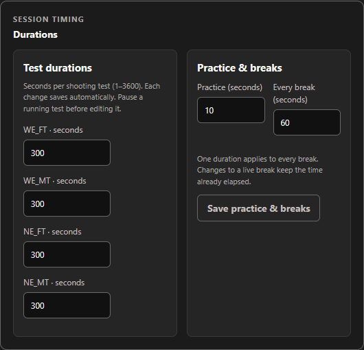 |
| Drag the **six-dot handle** (or focus it and use ↑/↓). Escape cancels. Order locks once a session starts. | Enter seconds per scenario (default **300**), click outside to save. Set **Practice** and **Every break**, then **Save practice & breaks**. |

> [!NOTE]
> The study plan calls for two-minute breaks: set **Every break** to **120** seconds. The walkthrough never changes your settings on its own.

To reuse a setup, type a **Preset name** under **Saved setups** → **Save setup**; later choose it → **Load**. Presets are stored in that browser.

### 3 · Create the participant recording

Click **New participant**, enter the **Participant number / ID** (name and notes are optional) and click **Create recording**. This saves the details; it does not start a scenario.

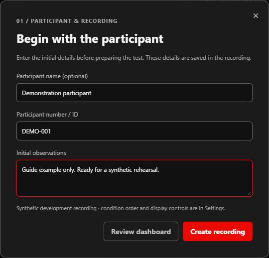

### 4 · Begin the walkthrough

Click **Begin tutorial / walkthrough**. The participant window guides the participant step by step ([see every screen below](#-the-participant-walkthrough)) while the dashboard tells you what to do next.

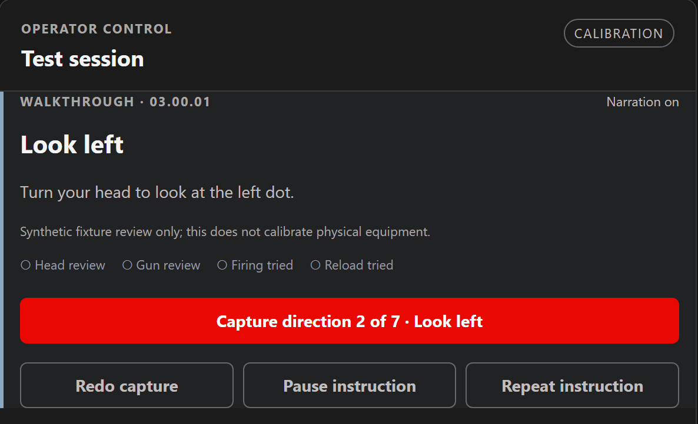

- **The big red button is always your next action**, for example *Participant is ready*, *Capture direction 2 of 7*, *Start practice* or *Confirm form completed*. It stays disabled until the current narration finishes.
- **Pause instruction** / **Repeat instruction** pause or replay the current narration and picture. Repeating never re-captures, re-fires or restarts anything.
- **Redo capture** discards the head directions and starts them again.
- During practice: **Pause practice**, **Restart practice**, **Finish practice**.
- The checklist (head review, gun review, firing tried, reload tried) only fills from real events.

<br clear="right">

### 5 · Let the study run

After the overview the first scenario arms by itself. The participant sees **Shoot to begin** and pulls the trigger once; that start shot is not scored. From then on, scenarios and breaks follow each other automatically: each scenario saves, a break counts down, and the next scenario starts when tracking is valid. After the final break the participant fills in the post-study form, you click **Confirm form completed**, and the thank-you screen appears.

<details>
<summary><b>Running a session without the walkthrough (manual mode)</b></summary>

<br>

Check the condition and duration in **Current task**, then click **ARM TEST** when the participant is ready. **DISARM TEST** cancels before they start.

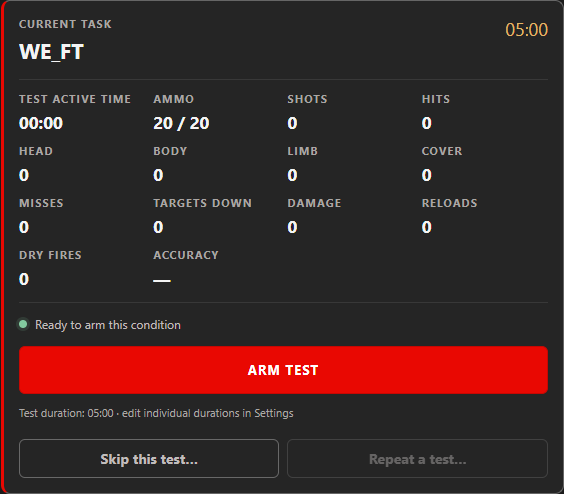

After each test: wait for saving, click **Start break** (waiting beforehand uses no break time), let it count down or click **Skip break**, then **ARM TEST** for the next one.

| Waiting to start the break | Break counting down |
| :---: | :---: |
| 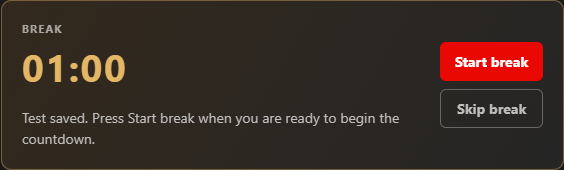 | 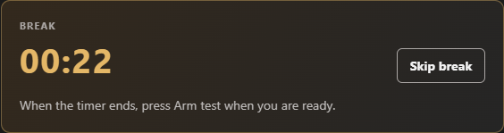 |

After the final test, complete or skip its break to close the recording.

</details>

### 6 · Pause, stop or add a note

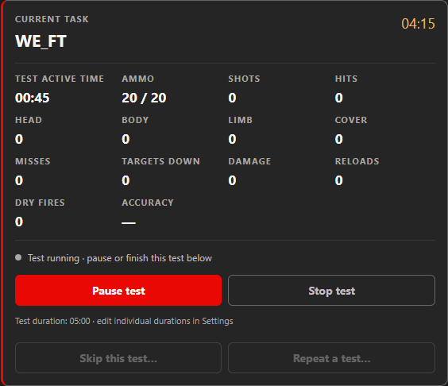

| Button | What happens |
| --- | --- |
| **Pause test** / **Resume test** | Freezes the timer and targets, then continues the same attempt |
| **Stop test** | Ends early after a confirmation. Saved as **Stopped early**; it cannot resume |
| **Add note** (scroll down) | Saves an observation to the session's note history |
| **Skip this test…** | Skips a ready, unarmed scenario with a reason |
| **Repeat a test…** | Adds another attempt with a reason; earlier results are kept |
| **Skip break** | Ends the current break early |
| **Abort participant session** | Ends the whole session, including remaining scenarios. Use only on purpose |

### Participant controls (desktop rehearsal)

| Action | Input |
| --- | --- |
| Aim | Move the mouse |
| Fire one round | Click and release |
| Reload (20-round magazine, never automatic) | **R** |
| Move forward / back · left / right · down / up | **W / S** · **A / D** · **Q / E** |
| Reset the virtual pose | **Home** |
| Fullscreen on / off | **F11** or **Alt + Enter**, **Esc** to restore |

Targets have three health points: head, body and limb hits deal 3, 2 and 1 damage. Switching windows does **not** pause the timer. See [desktop input](docs/modules/desktop-input.md) for details.

---

## 🎓 The participant walkthrough

A narrated, step-by-step tutorial on the participant window replaces the old instructional video. It is built for someone who has never seen the study: **one picture and one instruction per screen**, a progress bar across the top, and a badge that always says what to do right now.

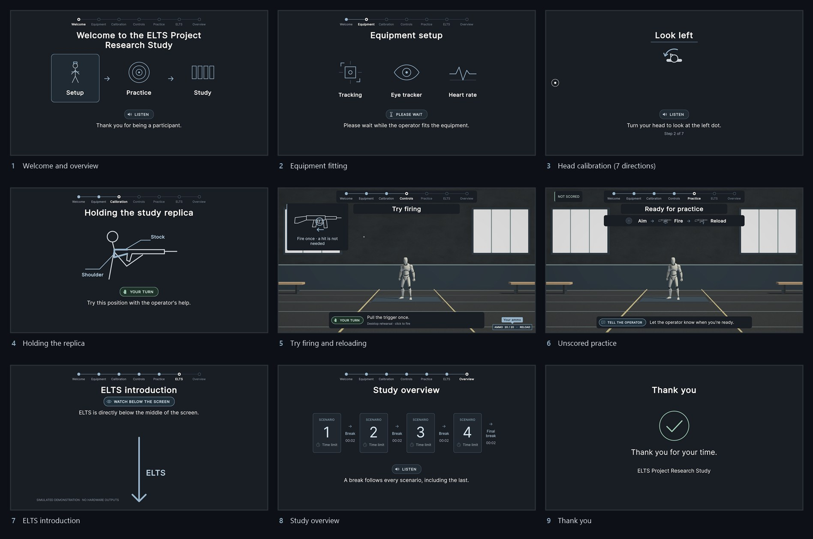

**What the badge means**

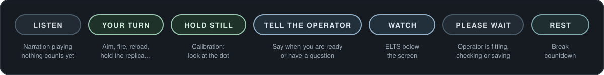

The badge says **Listen** until the narration ends. Shots, reloads and captures only count after that, so an early trigger pull is simply ignored.

**Calibration steps.** Each head direction shows a simple picture from above with a turning or stepping arrow, and a single ringed dot to look at. The operator captures each direction, then reviews and accepts it.

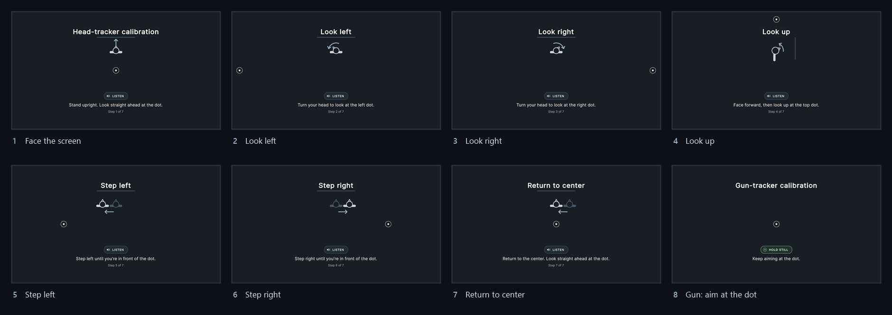

| Part | What the participant does | What you do |
| --- | --- | --- |
| Welcome | Listens; says when ready | **Participant is ready** |
| Equipment | Gets fitted; mentions any discomfort | **Equipment fitting finished**, then **Equipment checked** |
| Calibration | Looks at 7 dots, tries the holding position, aims at the gun dot | Capture each direction and accept the review; **Holding position tried · comfortable**; capture and accept the gun step |
| Controls | Aims, fires once, reloads once (a hit is not needed) | **Aiming tried and understood**; firing and reloading are detected automatically |
| Practice | Practises freely; not scored | **Start practice** (the timer starts after the instructions), then **Ready for the simulated ELTS demonstration** |
| ELTS demo | Looks below the screen, then asks any questions | One **simulated** demonstration runs (no hardware outputs); then **Questions answered · continue** |
| Overview | Learns about 4 scenarios, time limits and breaks | Nothing; it leads straight into the study |

> [!NOTE]
> All 39 narration clips are recorded and bundled. The wording lives in the [tutorial script](docs/participant-tutorial-script.md) (a plain [reading copy](docs/participant-tutorial-reading-script.md) is generated from it). Visual settings such as dot positions are in `ParticipantTutorialSettings.json`. Full details: [walkthrough guide](docs/modules/participant-tutorial.md).

---

## 📊 Review and export data

Click **Data** at the top of the dashboard. Click **Test administration** to go back; switching views never pauses a running test.

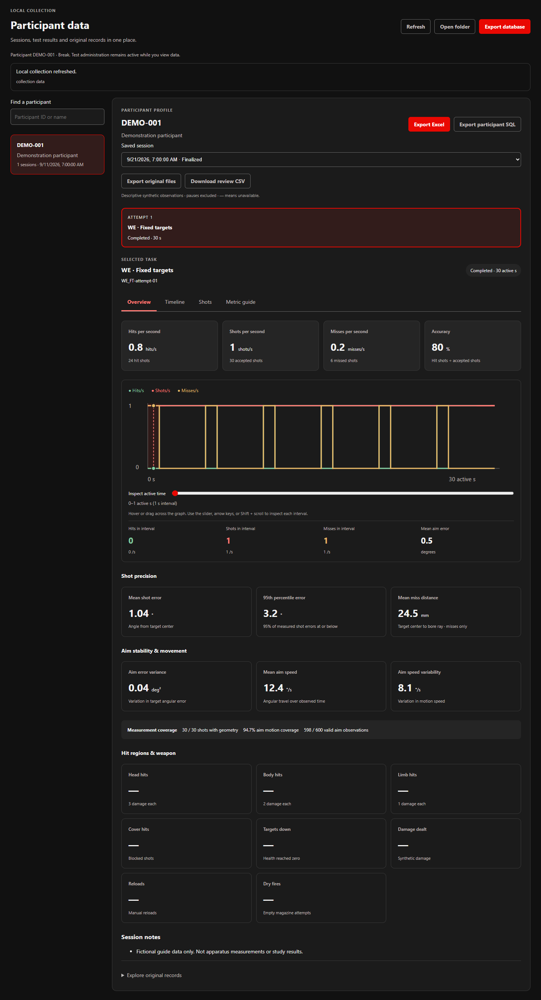

1. **Find the participant** by ID or name. Reusing an ID groups all their sessions under one profile.
2. **Pick a session, then an attempt.** Tabs: **Overview** (rates, accuracy, shot error, aim stability) · **Timeline** · **Shots** · **Metric guide**.
3. **Refresh** picks up newly saved recordings.

| Timeline: drag across the graph | Shots: filter hits, misses, unknown |
| :---: | :---: |
| 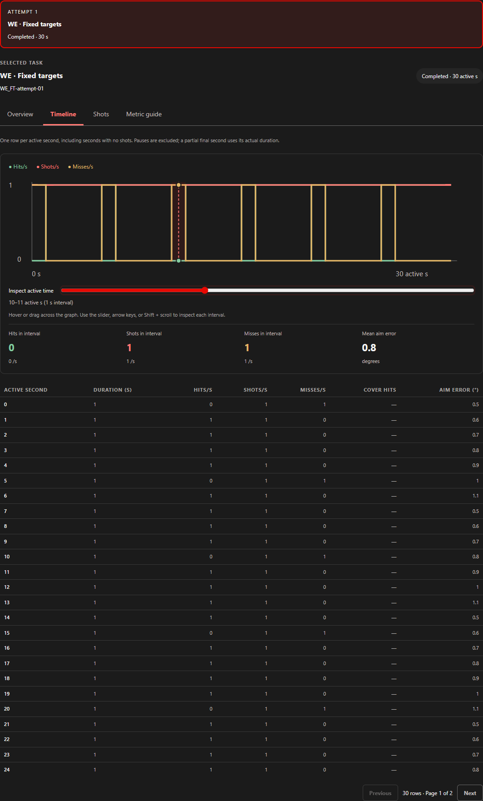 | 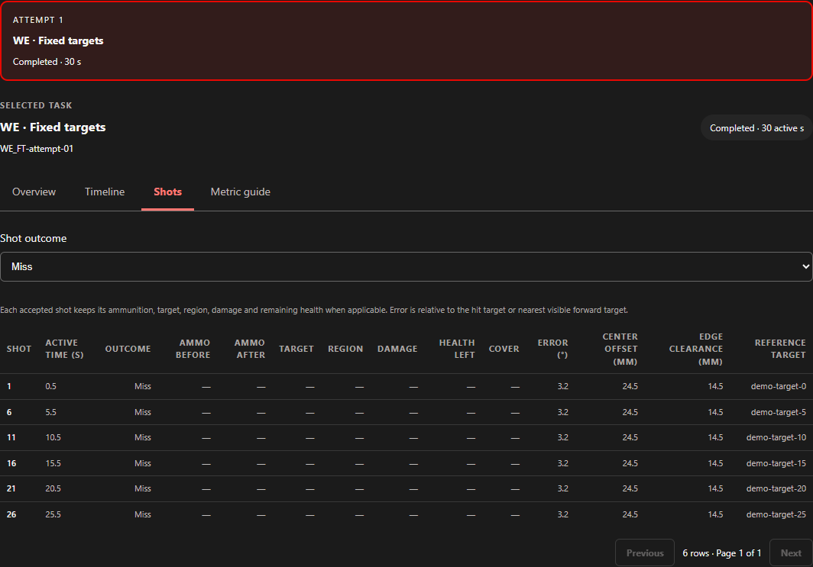 |

A **—** means a value is unavailable, not zero. Active time excludes pauses.

| Export | What you get |
| --- | --- |
| **Export Excel** | The participant's sessions as `.xlsx` (Tasks, Timeline, Shots, Metric guide). Excel isn't needed to create it |
| **Export participant SQL** | One participant as a standalone `.sqlite` database |
| **Export database** | The whole collection as `.sqlite` (with `task_results`, `task_seconds`, `task_shots` views) |
| **Export original files** | A ZIP of one finished session's raw streams and checksums |
| **Download review CSV** | Task summaries for the selected session |

Click **Download export** to save a prepared export; copies also stay in the data folder's **exports** directory. **Open folder** shows the data folder itself.

> [!WARNING]
> Data stays on **this computer** in the **collection data** folder beside this README. It is excluded from Git, so pushing the project does **not** back it up. Wait for saving to finish before closing ELTS. More: [data storage and recovery](docs/modules/data-collection.md).

---

## 🎯 Calibration workspace

A separate browser app for describing the room: screen size and position, base-station location, head and weapon mount offsets, a 3D room view and a view from the participant's eyes. It never starts ELTS and its profiles are stored apart from ELTS recordings.

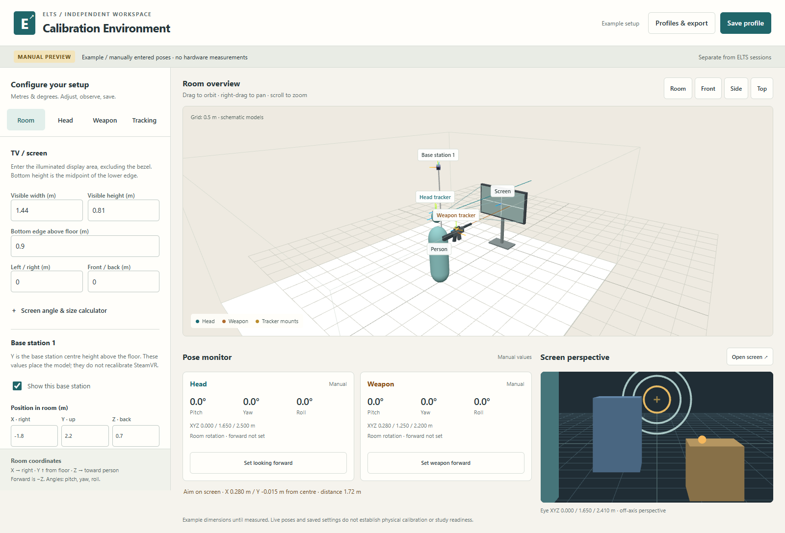

1. On a new tracking PC, run **SETUP-TRACKING.cmd** once (Python, OpenVR, Steam and SteamVR; headset-free tracking with backups of existing settings).
2. Run **START-CALIBRATION.cmd**. **Manual preview** works with no equipment; live mode reads SteamVR trackers.

See the [calibration workspace guide](Calibration%20Environment/README.md). Example values are not measurements; software checks do not establish physical calibration.

## 🧩 Offline apparatus simulation

Open [elts-simulation/index.html](elts-simulation/index.html) from your downloaded folder in any browser. Orbit the scene, choose a condition, move the participant, change the display width and use **Explore equipment** to find each component. No install or server; it doesn't run sessions or touch hardware. [Simulation guide](elts-simulation/README.md).

---

## 🛠 Troubleshooting

| What you see | What to do |
| --- | --- |
| **Offline** at the top of the dashboard | Make sure the participant window is still open, then refresh the browser |
| The big walkthrough button is gray | Let the narration finish; then complete the step it names |
| **ARM TEST** is disabled | Finish the walkthrough/practice or break and wait for saving |
| Scenario order won't change | It locks during a session; change it before the next participant |
| A save fails or a recording looks incomplete | Read the message and keep the files; don't treat it as finalized |
| Startup stops with an error | Read the startup window, then [setup troubleshooting](docs/operator/multi-machine-setup.md#if-something-goes-wrong) |
| A device, export or analysis step fails mid-session | [Session troubleshooting](docs/operator/troubleshooting.md) |

Full reference: [administrator dashboard](docs/modules/operator-dashboard.md).

---

## 📌 Project status

| Area | Status |
| --- | --- |
| Interactive participant walkthrough with recorded narration | ✅ In the development build |
| Practice room (separate, unscored, timed) | ✅ In the development build |
| Procedure briefing and automatic scenario → break → form flow | ✅ In the development build |
| ELTS introduction and demonstration | 🟡 Simulated only; real apparatus not connected |
| ELTS integration and synchronization | 🟡 Protocol fixture and [simulated controller](jetson/README.md) only; needs the controller's wire contract |
| Physical participant controller (mock replica input) | ⬜ Not started |
| Heart-rate, eye-tracker and NASA-TLX data alignment | ⬜ Not started |
| Room survey: screen size and 5 / 6 / 7 ft floor marks | ⬜ Measurements pending ([checklist](docs/operator/hardware-follow-up.md#current-inventory-and-starter-room-survey)) |

**Current tracking hardware** (confirmed October 21, 2026): one base station, two Vive trackers, existing tracker mounting posts and a headband with mounts. Having the equipment does not establish calibration, tracking coverage, mount rigidity, safety or study readiness.

---

## 👩‍💻 For developers

| Folder | Contents |
| --- | --- |
| `unity/` | Unity app: tracking, calibration, sessions, walkthrough, rendering, logging and the dashboard |
| `Calibration Environment/` | [Standalone room and tracker setup](Calibration%20Environment/README.md) |
| `elts-simulation/` | [Offline browser simulation](elts-simulation/README.md) |
| `analysis/` | [Run ingestion and analysis](docs/modules/analysis.md) |
| `config/`, `schemas/` | Editable settings and data contracts |
| `scripts/`, `tools/` | Setup, build, validation, packaging and tests |
| `docs/` | [Architecture](docs/architecture.md) · [developer commands](docs/operator/developer-quick-start.md) · [CI](docs/modules/ci.md) · [tutorial audio workflow](docs/participant-tutorial-audio-workflow.md) |
| `jetson/` | [Controller integration limits](jetson/README.md) |

Portable software checks (Python 3.10+):

```powershell
python tools/ci/check.py --baseline
```

`scripts/test.ps1` runs selected suites; `scripts/verify.ps1` runs full development verification, including available Unity and runtime tests. Working on more than one PC: pull, edit, review, commit and push before switching.

Configuration, geometry, tracker bindings and endpoints stay adjustable. Research recordings and machine-local settings stay out of Git.
