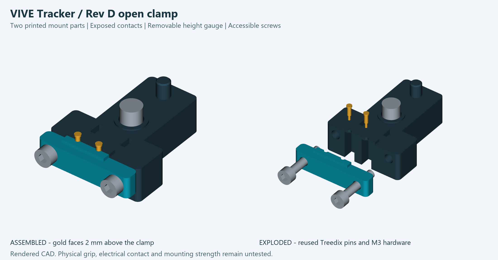
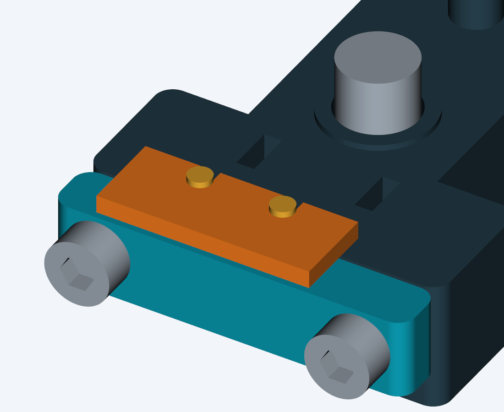

# Rev D — open clamp tracker attachment

A new two-piece mount for the existing Treedix 6 mm contacts. The fixed frame
attaches to the tracker; a front jaw grips the two stationary pin barrels with
two accessible M3 screws. The large flat gold bases face the tracker. Their
unused moving tips point downward.



This is a new prototype, not a physically proven fix. CAD checks cannot establish
printed fit, clamp friction, electrical contact, mounting strength or calibration.

## Why change the architecture?

| Earlier attachment | Rev D |
|---|---|
| Body, two tiny inserts and a cover | One frame and one front jaw |
| Contact bases behind small windows, or adhesive retention in Rev C | Entire gold bases exposed; screw clamp on stationary barrels |
| Hidden contact seating | Open front and underside for visual inspection |
| Fixed pin height | Removable setup forks set three contact heights |
| Separate screw spacers / reserved additional mount | One defined main-bolt bearing thickness |
| Enclosed wire cavity | Accessible solder reliefs and cable-tie slots |

At the nominal setting the gold faces stand **2 mm above the plastic grip**.
This is exposure above the redesigned lower grip, **not a 2 mm increase into
the tracker**. The nominal metal face remains at Z=2.515 mm relative to the
tracker's mounting-ring face. The reported approximate 4 mm gap is not a measured
dimension and is not established as solved by this CAD redesign.

Broad copper contact pads were considered, but would require fabricating new
metal contacts. Longer spring tips would preserve the difficult spring-to-spring
interface. This clamp reuses the existing pins and screws while removing the
small retaining lips and adhesive. Its tradeoff is reliance on actual barrel
grip: both pins must resist slipping after tightening. There is no positive axial
pin stop after the setup fork is removed.

## Print these parts

| File in output/ | Quantity | Purpose |
|---|---:|---|
| mount_frame.stl | 1 | Main mount and fixed half of pin clamp |
| clamp_jaw.stl | 1 | Movable front half of pin clamp |
| setup_gauge_lower_0p0mm.stl | 1 | Nominal contact height; 1.50 mm thick fork |
| setup_gauge_lower_0p25mm.stl | Optional | Lowers both contacts 0.25 mm; 1.25 mm fork |
| setup_gauge_lower_0p5mm.stl | Optional | Lowers both contacts 0.50 mm; 1.00 mm fork |

STLs are bed-aligned. Start at 100% scale in PETG, 0.16 mm layers, five walls,
40% infill. Use a finer layer height for the forks and **measure their finished
thickness**. The horizontal screw holes, nut recesses and wire-slot roofs need
slicer inspection; removable local supports may be needed. Do not put trapped
supports in the 1.6 mm grip bores. These print settings are starting points.

Only two plastic parts remain on the mount. The fork is a setup tool and must
be removed before fitting the tracker. Metal references in the assembly STEP
are not printable parts. The assembly does not include a wire or insulation model.

## Hardware

- Two existing Treedix B0BFD27HSR **6 mm** pins: nominal 2 mm flange, 1.5 mm
  stationary barrel, 0.9 mm moving tip. Confirm the received parts match.
- Two **M3 x 16 socket-head screws** and two standard M3 nuts from the existing kit.
- Existing **1/4-20 UNC x 5/8 inch** button-head screw. M6 is not a substitute.
- Two insulated flexible wires, individual solder-joint insulation, cable sleeve
  and a 2.5 mm cable tie as suitable for the actual assembly.
- Existing isolated normally open switch.

**Do not reuse the old loose mounting-bolt spacers with this frame.** Its bearing
stack is 11.375 mm, yielding nominal 4.5 mm projection from a 15.875 mm screw.
The button head is externally accessible under the frame. This version does not
reserve thickness for the previously planned additional mount. It is the tracker
connector, not a designed rifle bracket. Adding a plate, washer or different screw
requires recalculating the stack and checking real projection and seating.

## Assemble on the bench

1. Inspect and clean the print. Check the two grip halves are intact and the
   bores, screw holes and nut recesses are open. Load M3 nuts into the two rear
   hex recesses. Keep them in place while starting the screws from the front.
2. Before final clamping, solder short leads to the **stationary barrels near
   their lower ends**, outside the plastic. Let them cool and insulate each joint
   separately. Do not solder the gold bases or the moving tips. At nominal height
   about 0.885 mm of stationary barrel lies below the grip; verify the real joint
   fits the 4 mm relief and cannot touch the other lead.
3. With screws loose, place the pins in the rear half grooves, wide flat gold
   bases up. Fit the front jaw. The moving tips must remain free and unloaded.
4. Place the nominal fork around the barrels, resting on the raised grip bridge.
   Set both flange undersides against its top face. The fork holds the correct
   **height**, not clamp force. Its open slots face toward the central mounting hole.
5. Tighten the two M3 screws gradually and evenly until both barrels are gripped.
   Do not crush a barrel or force the plastic faces completely together. The
   nominal 0.3 mm split is closing allowance, not a specified final gap or torque.
   If the jaw bottoms out while a pin remains loose, revise grip_bore after
   measuring the print and pins. Do not compensate by overtightening.
6. Slide the fork forward, away from the central mounting hole. **Remove it.**
   Check each pin independently for slipping and verify both gold faces stay
   level and exposed. This is the key unvalidated retention feature of the design.
7. Route insulated leads down through the open reliefs, leaving a relaxed bend.
   Sleeve and secure the cable with the tie through the two frame slots. Keep
   wires clear of the main bolt and off the unused moving tips. Pull on the
   sleeved cable gently to check strain reaches the tie rather than the joints.



The alternative forks reduce the nominal face height to 2.265 or 2.015 mm;
they do not add travel beyond the modeled tracker envelope. Select a setting
from real seating/contact evidence, not by forcing the tracker down. Do not
adjust screw clamping with the tracker mounted: remove it and use the fork.

## Mount and connect

Confirm the main screw's actual projection before installation. Align the
locating post and seat the frame squarely on the mounting ring. Tighten gently
with the correct key. If it does not seat, inspect the stack and alignment;
do not use the bolt to pull it across a gap.

Viewed at the adapter's tracker-facing side with the locating post above the
mounting hole: the left installed contact (X=-5.25 mm) is **ground, pin 2**;
the right installed contact (X=1.75 mm) is **trigger, pin 4**. Connect those only
through the isolated normally open switch (COM to ground, NO to trigger).
No external supply or added pull-up. Do not solder onto the tracker.

Before use, check released/open and pressed/closed continuity, isolation from
unused contacts and fasteners, actual tracker input, pin retention and strain
relief. Repositioning the tracker or changing its mount requires the project's
geometry/calibration checks; CAD does not establish study readiness.

## Digital checks and editable source

`parameters.json` holds dimensions in mm. Run, in an environment with CadQuery
2.8.0, VTK and Pillow:

```
python build_connector.py
python validate_connector.py
python render_connector.py
python package_connector.py
```

The official model must be at the repository-relative location
`../official-model/VIVE_Tracker_3.0_3D_STP/VIVE_Tracker_3.0_3D.stp`.
Checks cover valid solids, closed connected meshes, print-bed placement, part
collisions, tracker-shell clearance, modeled spring contact, tool access,
gauge withdrawal and the main screw stack. Spring overlap represents the unloaded
HTC reference shape; it does not measure spring compression force or real contact.
The exported assembly shows nominal uncompressed geometry before final jaw closure.

`output/verification.json` records results and source/output hashes. The package
script refuses stale geometry validation. STEP files are editable solids, not
a native CAD feature history. All earlier revisions are preserved.

Geometry and pin mapping come from the saved HTC developer guide v1.1 and official
STEP. Hardware dimensions are the prior nominal selected-part dimensions, not new
measurements. See the adjacent Rev B documentation for the original sources.
