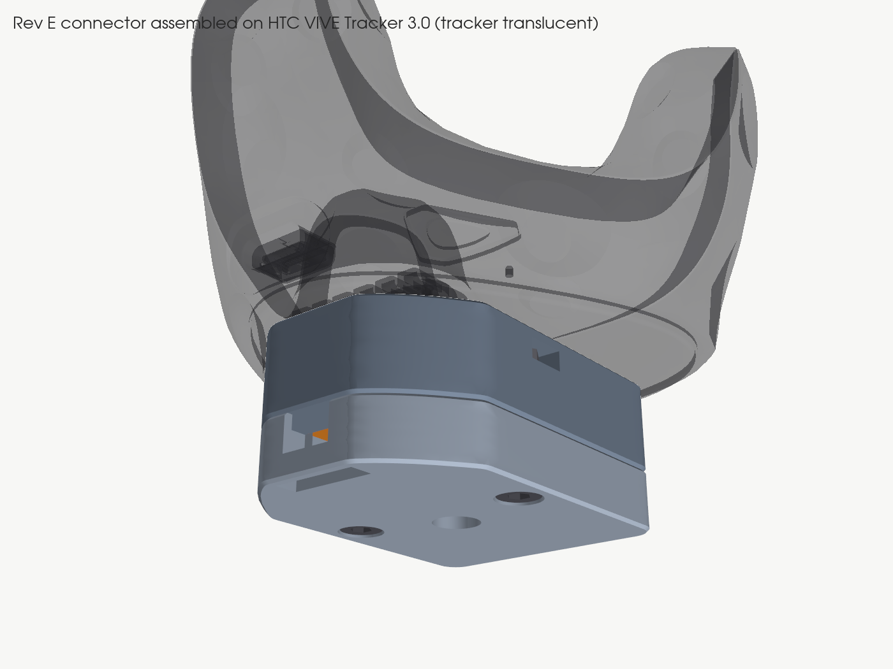

# Rev E: VIVE Tracker 3.0 trigger connector

Status (2026-11-06): **digital design only.** Nothing has been printed, fitted to a tracker or electrically tested. The checks below are CAD and mesh checks against nominal dimensions and HTC's tracker STEP. They are not physical validation.

Rev E was designed from scratch from HTC's documents and CAD. It does not reuse geometry from Revs A–D.



## What it does

Two Treedix 6 mm pogo contacts are fitted upside down. Their flat stationary bases are the mating pads for the tracker's spring pins 2 and 4. The moving tips point away from the tracker and carry no load. A passive, isolated normally open switch joins them:

```text
tracker pin 4 (trigger, internal pull-up, active low) ── contact "4" ── wire ── switch NO
tracker pin 2 (GND)                                   ── contact "2" ── wire ── switch COM
pins 1, 3, 5, 6: not connected (no metal near them; pin 3 sits over a relief hole)
```

Pressing the switch pulls pin 4 to ground, and releasing it opens the circuit. There is no external supply and no added pull-up, and nothing is soldered to the tracker. HTC gives the GPIO absolute maximum as 4 V, and this circuit applies no voltage at all.

## Files

| Path | What |
|---|---|
| `output/ELTS_VIVE_Tracker_3_Trigger_Connector_Rev_E.step` | **Open this in Fusion.** Assembly with named components in assembled positions: `PRINT_mount_base`, `PRINT_contact_carrier`, `PRINT_bottom_cover`, and a `HARDWARE_REFERENCE_not_printed` sub-assembly holding 2 contacts, the 1/4-20 screw, 2 M3 screws and 2 nuts |
| `output/..._with_tracker_reference.step` | Same assembly plus HTC's tracker model (`REFERENCE_HTC_VIVE_Tracker_3_0_not_printed`), for checking the fit (about 30 MB) |
| `output/parts/*.step`, `output/hardware/*.step` | Each component on its own, in assembled position |
| `print/*_mount_base.stl/.3mf`, `*_contact_carrier.*`, `*_bottom_cover.*` | **Printable parts only**, already in print orientation. No hardware is included in these files |
| `previews/*.png` | Assembled (on the tracker, top and underside), exploded, and the carrier's soldering side |
| `parameters.json` | Editable inputs, grouped into HTC-sourced values, nominal hardware, design choices and print allowances |
| `tracker_interface.json` | Interface dimensions measured from HTC's STEP by `inspect_tracker.py` (generated, so don't edit it by hand) |
| `output/derived_dimensions.json` | Every calculated dimension with its formula (generated) |
| `output/verification.json` | Results of the digital checks (generated) |
| `inspect_tracker.py`, `build_connector.py`, `validate_connector.py`, `render_connector.py` | CadQuery source, which is the editable parametric definition |

**About Fusion:** there is **no native `.f3d`/Fusion archive** in this package. Fusion is installed on this PC but can't be driven headlessly from here, and I won't rename another format to look like one. The STEP opens normally in Fusion as an assembly of separate, named components. Their bodies are *imported solids with no feature timeline*. To change the design parametrically, edit `parameters.json` and re-run the scripts. To make quick local changes, use Fusion's direct-edit tools on the imported bodies.

## How the interface was determined

Sources:
- HTC *VIVE Tracker (3.0) Developer Guidelines* v1.1 (`../HTC_Vive_Tracker_3.0_Developer_Guidelines_v1.1.pdf`), printed pages 13–17. It was downloaded again from the link you gave, and its SHA-256 is identical to the repo copy. (HTC's product page still links v1.0.)
- HTC `VIVE_Tracker_3.0_3D.zip`, downloaded again (identical to the repo copy). The STEP is `../official-model/VIVE_Tracker_3.0_3D_STP/VIVE_Tracker_3.0_3D.stp`, with SHA-256 recorded in `tracker_interface.json`.

Results, in HTC's model frame (socket axis = Z, recess on +Y, pins on −Y):

| Feature | Value | Source |
|---|---|---|
| Broad flat underside (**seating surface**) | z = −2.50 | CAD (largest lowest plane) |
| Datum A, the ring around the 1/4" nut | z = −2.00, i.e. 0.50 **above** the flat underside | CAD; definition from guide p.18 |
| 1/4" socket bore | Ø6.35, from z −1.99 to the bottom at z +5.75 (7.74 deep from Datum A) | CAD (thread form not modelled) |
| Stabilizing recess | at y = 13.97, Ø5.30 entry tapering at 2.5° to Ø4.80, floor at z +4.00 | CAD |
| Stabilizing pin for accessories | Ø4.20 ± 0.10, 4.700 above Datum A, 14.001 from the socket axis | guide p.15–16 |
| Tracker pogo pins | six Ø1.3 spherical-tip pins, 3.5 mm pitch at x = ±1.75/±5.25/±8.75, y = −16.52, tip at z −0.586 *as modelled* | CAD; pitch matches guide p.16–17 |
| Accessory pad height | 2.595 above Datum A (pads 2.0 × 4.1, centred 16.969 from the axis) | guide p.15–16 |
| Friction pad | pocket x −26.7…−6.1, y 1.9…17.9; rubber protrusion **not in CAD** | CAD |

**Pin numbering.** The guide's views on p.13 and p.14 look at the tracker's underside: recess up, pins below, friction pad to the right, and pins numbered 6‑5‑4‑3‑2‑1 left to right, so pin 1 is on the friction-pad side. In HTC's CAD the friction pad is at −X, so **pin 1 is at x = −8.75, pin 2 (GND) at x = −5.25, and pin 4 (trigger) at x = +1.75**. As a cross-check, the accessory drawing (p.16–17) puts pin 1 at accessory X = +8.75 with accessory X pointing to model −X, which gives the same result. `validate_connector.py` re-checks this rule.

**Design frame ("seat Z").** Z = 0 is the connector's top face, which is the tracker's flat underside, and +Z points into the tracker. The seat-Z positions of the key features are:

| Item | seat Z | How |
|---|---|---|
| Datum A | +0.50 | CAD |
| Contact face (top of each Treedix base) | **+3.095** | Datum A + HTC pad height 2.595 |
| Tracker pin tip as modelled | +1.914 | CAD, so nominal pin compression is **1.18 mm** |
| Treedix barrel bottom / tip end | −0.905 / −2.905 | 0.5 + 3.5 + 2.0 nominal |
| 1/4-20 screw tip | **+5.00** | design choice: 4.5 above Datum A |
| 1/4-20 head bearing face | −10.875 | tip − 15.875 under-head length |
| Stabilizing pin top | +5.20 | Datum A + 4.700 |

## Design

Three printed parts, plus the hardware you already have.

**`mount_base`** (34 × 47.5 × 12 mm plus the pin). Its flat top face seats on the tracker's broad flat underside, not on Datum A, which is recessed 0.5 mm. The footprint is the tracker's flat underside outline inset 1.5 mm, so nothing extends beside the tracker and the sensors stay unobstructed. It also has:
- an integral Ø4.20 stabilizing pin (HTC size), 5.20 tall with a 0.6 mm lead-in chamfer;
- a 1.2 mm relief over the friction-pad pocket, so an unknown rubber protrusion can't rock the tracker;
- a Ø6.8 clearance hole and a Ø11.8 counterbore for the 1/4-20 screw;
- a channel that receives the carrier from below, and a window through the 2 mm top skin;
- two side-entry M3 nut slots.

**`contact_carrier`** is removable. The two contacts sit with their flat bases on the top face of a plate that rises through the base into the tracker's pogo port. The barrels pass through Ø1.6 holes (ream to 1.5). Below the plate the carrier is open on +Y and on both ends, leaving **2.1 mm of each barrel exposed** for soldering and sleeving on the bench. A collar stops upward travel under the base skin. Two legs (labelled **2** and **4**) stand the carrier on the cover.

**`bottom_cover`** (8 mm). It supports the carrier, so the tracker pins' force goes into the cover. It also keeps the 1/4-20 screw captive (0.4 mm axial play) with a Ø6.2 hole for the hex key. It provides a wire bay and a 7 × 5 mm cable channel to the −Y edge, and a cable-tie anchor: two floor slots plus a groove underneath, so the strap sits below flush. The cover is held by two M3 × 16 screws, fully recessed, into nuts in the base.

**Contact retention.** Downward, the tracker pins push each contact base onto the plate, which rests on the cover, which is held by the M3 screws. Upward, the solder joint and its sleeve under the plate cannot pass back through the Ø1.5 hole. The carrier itself is held between the cover (below) and the base skin (above, 0.1 mm float).

**Mounting-screw bearing stack.** The screw head bears directly on 10.875 mm of printed base, which bears on the tracker's flat underside. The screw protrudes 5.00 mm. That gives **4.49 mm thread engagement (3.5 threads)** and **3.25 mm clearance** to the bottom of the CAD socket. The stabilizing pin prevents the tracker from rotating while you turn the screw.

**Fasteners.** Each M3 screw has its tip at −0.7 (0.6 mm skin below the tracker face), 1.1 mm past its nut, and a 12.5 mm grip. Its head is recessed 0.3 mm below the cover.

## Bill of materials

| Qty | Part | Use |
|---|---|---|
| 1 each | printed `mount_base`, `contact_carrier`, `bottom_cover` | |
| 2 | Treedix 6 mm pogo contact (B0BFD27HSR) | flat base up |
| 1 | SGTZH 1/4-20 × 5/8" button-head screw (B0B82124YW) | tracker mount; key 5/32" (≈3.97 mm) |
| 2 + 2 | Senyard SYD-511 M3 × 16 socket head + M3 hex nuts | cover; key 2.5 mm |
| 1 | 2.5 mm cable tie | strain relief |
| — | 2 flexible insulated wires, joint insulation, cable sleeve, isolated N.O. switch (COM + NO) | existing |

## Printing

| Part | Orientation (as in the STL/3MF files) | Supports |
|---|---|---|
| `mount_base` | bottom on the bed, stabilizing pin up | none |
| `bottom_cover` | bottom on the bed | none |
| `contact_carrier` | lying on its flat back (−Y) face, so the contact plate is a vertical fin | none |

Suggested settings: PETG (or ASA), 0.2 mm layers, a 0.4 mm nozzle, 4 walls, 40 % infill, and 100 % in the base around the 1/4-20 hole if your slicer supports modifiers. Use a matte, non-white filament (HTC advises against reflective surfaces near the sensors).

After printing:
1. **Pierce the one-layer bridges** over the 1/4-20 hole in the base and the two M3 holes in the cover. They are deliberate 0.2 mm bridges for clean printing. Use a 6.5 mm (or 1/4") drill by hand, or a 3 mm drill or the screw.
2. Open the two Ø1.6 contact holes with a **1.5 mm drill by hand** until a contact barrel slides in snugly and its base sits flat.
3. Test-fit the carrier in the base channel and the nuts in their slots. Check that the stabilizing pin measures 4.1–4.3 mm.

## Assembly

1. Push each contact into the carrier from the plate side until its flat base sits on the plate. The **"2" leg is −X** (pin 2/GND) and the **"4" leg is +X** (pin 4/trigger).
2. On the bench, solder the **COM wire to the barrel of contact 2** and the **NO wire to the barrel of contact 4**. Make each joint from the open +Y side, on the 2.1 mm exposed barrel below the plate. Keep solder off the moving tips. Insulate each joint separately. The design allows a Ø3.0 envelope per joint, and the joints are 7 mm apart.
3. Slide the two M3 nuts into the side slots of the base.
4. Turn the base upside down. Insert the carrier into its channel, wires first, until the plate shows through the window. Drop the 1/4-20 screw into its counterbore.
5. Lay the cable sleeve in the cover channel. Loop the cable tie down one slot, along the groove underneath, up the other slot and around the sleeve, then tighten it. The sleeve, not the joints, must take the pull.
6. Fit the cover, then insert and tighten the two M3 × 16 screws from below.
7. **Bench electrical check, with the tracker off:** across the two contact faces, expect continuity only when the switch is pressed and an open circuit when it is released. Also check that neither contact is shorted to the 1/4-20 screw.
8. Put the tracker on, aligning the stabilizing pin and the pogo port. Turn the 1/4-20 screw through the cover hole with a 5/32" key until it is snug. **Do not over-tighten**, because the head bears on plastic.

## Digital checks performed

See `output/verification.json` for the values. The script checks:
- **valid solids:** every part and reference is one valid B-rep solid;
- **printable meshes:** watertight, consistent winding, one body, volume within 1 % of the CAD, on the bed;
- **interference:** all component pairs, and each printed part against HTC's tracker;
- **clearances:** carrier and stabilizing pin to the tracker; the base face seats on the tracker;
- **contact alignment:** each contact is on its pin axis at HTC's pad height; its overlap with the tracker is that pin's tip only; the unconnected pins stay clear;
- **fasteners:** 1/4-20 engagement, bottoming margin, head bearing and captivity; M3 nut engagement and tip position;
- **tool access and assembly paths:** hex-key envelopes, the nut insertion paths, the carrier insertion path, and soldering and insulation room;
- **sensors:** the footprint is inside the tracker's flat underside, and everything above the seat plane is inside the tracker's own recesses.

Result on 2026-11-06: **47 passed, 0 failed (digital only).** Key values:

| Check | Result |
|---|---|
| Solids | 3 printed parts and 7 hardware references, each one valid solid |
| Meshes (6 files) | watertight, one body, mesh volume within 1 % of CAD, flat on the bed; largest part 34 × 47.5 × 17.2 mm |
| Component interference (45 pairs) | none, apart from the three intended 0.2 mm print bridges (1.41, 1.41 and 6.33 mm³) that you pierce before fitting the screws |
| Printed parts vs tracker | 0.000 mm³ for all three; the base face meets the flat underside (distance 0) |
| Carrier to tracker clearance | 0.55 mm minimum, excluding the pin 2/4 bodies that the contacts are meant to press |
| Stabilizing pin in recess | 0.35 mm minimum; pin top 5.20, recess floor 6.50 |
| Contacts 2 and 4 | 0.00 mm off the pin axes (±1.0 mm acceptance), face at the HTC pad plane, 1.18 mm modelled compression, overlap with the tracker is only that pin's tip |
| Pins 1, 3, 5 and 6 | ≥1.85 mm from either contact and ≥0.55 mm from any plastic |
| 1/4-20 | 4.49 mm engagement (3.54 threads), 3.25 mm bottoming margin, head bears on the base, captive with 0.4 mm play |
| M3 | full nut engaged, tip 1.1 mm past the nut, tip 0.6 mm below the tracker face, heads recessed 0.3 mm |
| Tool access | 5/32" key and 2.5 mm key clear; nuts slide in; carrier inserts from below; 2.1 mm of barrel and a Ø3 insulation envelope clear on each contact |
| Sensors | footprint inside the tracker's flat underside; above the seat plane only the pin, plate, contacts and screw, all inside tracker recesses |

## Not yet tested physically

- Print accuracy and fit on a real tracker: the stabilizing pin, the plate in the pogo port, the hole sizes and the nut slots.
- Contact resistance, isolation, and press/release recognition through SteamVR and the ELTS hardware adapter (see [the wiring guide](../wiring-guide.md)).
- Holding force of the strain relief, and torque/creep of the printed bearing under the 1/4-20 head.

## Specific uncertainties

1. **Tracker pin free length, stroke and force.** HTC gives the pad height but no pin stroke. The 1.18 mm nominal compression assumes the CAD shows the pins extended. If pin force exceeded the supported design, contacts would still be held, because the load goes into the cover.
2. **Treedix dimensions.** These are your nominal values. The listing could not be read (HTTP 503), so the tolerances are unknown. The base's 0.5 mm thickness sets the contact-face height directly.
3. **Pin row position in Y.** The contacts are centred on the CAD pin axis (16.52 from the screw axis). HTC's pad centre is 16.969, which is 0.45 away. Either way it lands within the Ø2.0 contact face.
4. **Stabilizing pin location.** HTC's drawing gives 14.001 and the CAD gives 13.97 (a 0.03 difference, which is covered by the ≥0.3 mm radial clearance in the recess).
5. **Socket thread depth.** The CAD bore is simplified (7.74 mm from Datum A). ISO 1222 was not consulted (paywalled). The chosen 4.5 mm protrusion above Datum A leaves a 3.25 mm margin. The screw length tolerance is unverified, and a typical −0.76 mm would still leave 3.7 mm engagement.
6. **Friction pad.** Its protrusion is not in the CAD, so a 1.2 mm relief is provided. If the pad stands proud by more than that, increase `friction_pad_relief_depth`.
7. **Cable tie, wires, sleeve, switch.** These have not been measured. The tie slots (2.0 × 3.2 mm) assume a strap no thicker than about 1.6 mm. The channel (7 × 5 mm) assumes a sleeve no larger than about Ø5. Both are parameters.
8. **M3 nut thickness** (2.4 mm). The slot is 2.7 mm high.

## Regenerating

With Python 3.13 and `requirements.txt` installed, run these from this folder:

```bash
python inspect_tracker.py
python build_connector.py --with-tracker
python validate_connector.py
python render_connector.py
```
