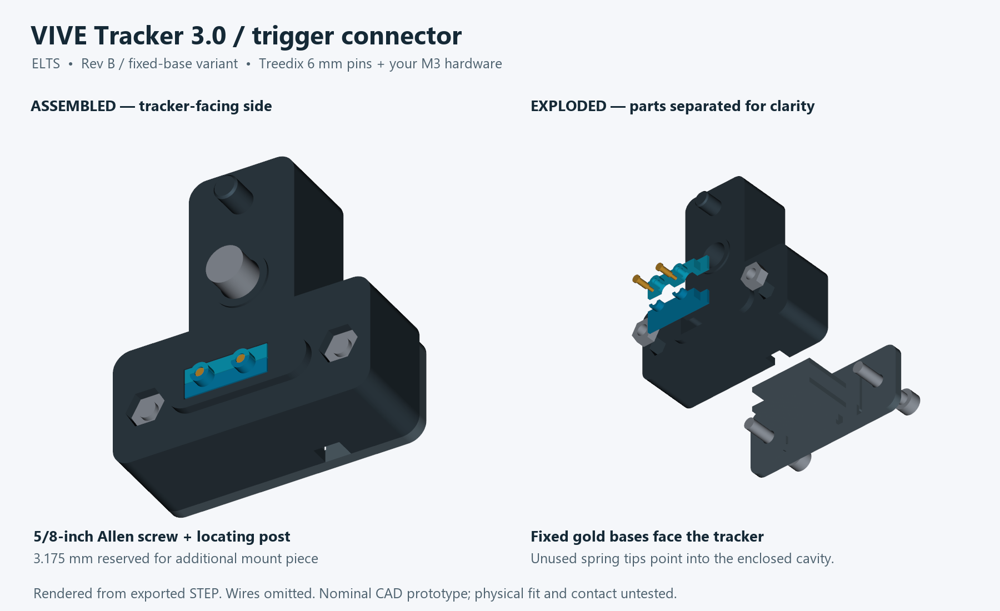
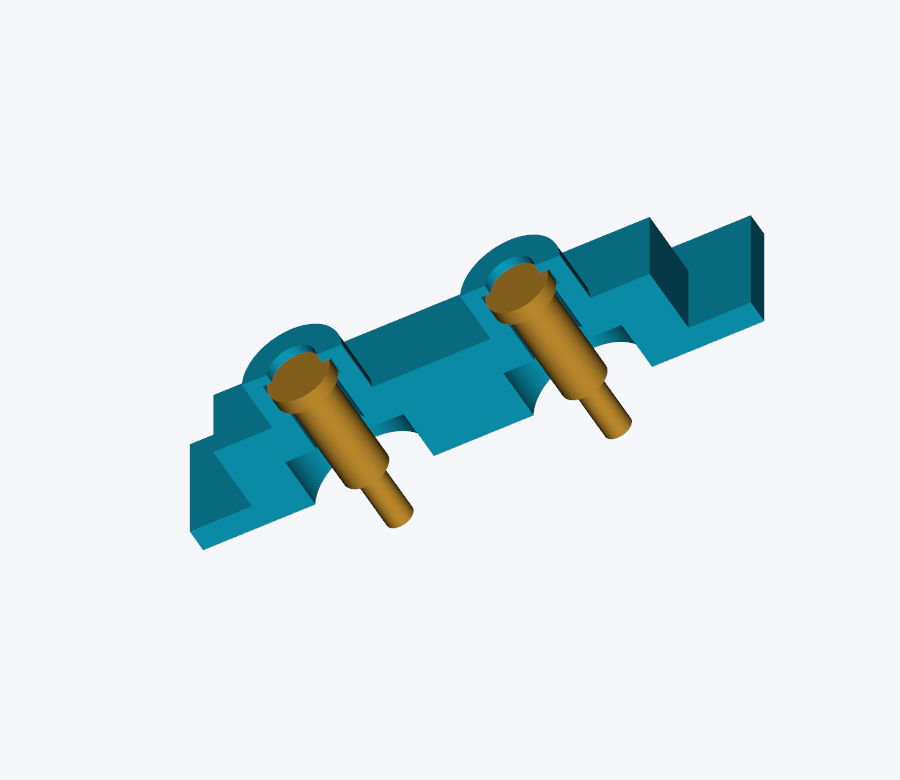

# VIVE Tracker 3.0 connector — Rev B, fixed-base variant

Revised for **Treedix B0BFD27HSR, 6 mm / 30-pack** and the **M3 hardware in your Senyard SYD-511 kit**. The earlier Mill-Max Revision A is preserved in `../connector/`.

**Use this folder's parts together.** This variant has a deeper body, a different contact insert, and a taller cover than Revision A. It is also separate from the other `connector-rev-b` draft; do not mix their parts.

**Status:** nominal CAD and mesh checks passed. The purchased pins, printed fit, solderability, mounting strength, and electrical contact have not been physically tested. The supplied photos establish the kit labels, not measured head/nut tolerances.



## What changed

- Two Treedix pins replace the Mill-Max contacts. **Their fixed, flat Ø2 mm bases face the tracker.** Their unused moving tips point down into the enclosed cavity. This avoids making a spring-tip-to-spring-tip connection.
- Each metal flange is retained in a split pocket. A Ø1.6 mm window exposes its gold base, and a 0.32 mm printed lip keeps it from falling out. The small windows are centered on the actual spring axes in HTC's STEP.
- The deeper body is retained. Your selected **SGTZH 1/4-20 x 5/8-inch button-head Allen screw** is included as a reference solid. Its extra **3.175 mm** is reserved for an additional mounting piece between the head and body shoulder. With that stack, thread projection remains **4.5 mm**. The additional piece itself is not included.
- The cover uses **two M3 × 16 mm socket-head screws and two ordinary M3 nuts**, without washers. These sizes are listed in Photo 1. The M2.5 kit in Photo 2 is not needed for this variant.

## Open or print

Open `output/ELTS_VIVE_Tracker_3_Trigger_Connector_Rev_B_Fixed_Base.step` in Fusion using **File → Open → Open from my computer**. It contains four plastic solids, two reference contacts, and five reference fasteners. These are editable STEP solids, not a native Fusion feature timeline.

Only print the following STL files, at **100% scale**:

| File in `output/` | Quantity | Starting orientation |
|---|---:|---|
| `mount_fit_coupon.stl` | 1 first | Supplied flat face down; no supports |
| `insert_front.stl` | 1 | Flange down as supplied; small brim if necessary |
| `insert_rear.stl` | 1 | Same as front insert |
| `body.stl` | 1 | Flat rear face down; removable build-plate supports in the wire cavity and main screw recess |
| `wire_cover.stl` | 1 | Flat exterior down; retaining rails upward |

Suggested starting settings: PETG, 0.4 mm nozzle, 0.16 mm layers, five walls, 40% infill. Inspect the slicer preview for both small retaining lips and the contact windows; these features must remain present and open. Do not scale the whole model to correct a tight hole.

**Hand-fit the mounting coupon without a screw.** Its thickness does not match the full body's screw stack. The mounting screw would project too far through the coupon. Print the two small inserts next and test them around two unsoldered pins before spending time on the body.

## Hardware to use

| Quantity used | Part | Source/status |
|---:|---|---|
| 2 | Treedix 6 mm pogo pins, Ø2 mm flat bases | [Selected Amazon 30-pack](https://www.amazon.com/dp/B0BFD27HSR); verify the **6 mm** variant |
| 2 | M3 × 16 socket-head screws | Senyard SYD-511, Photo 1 |
| 2 | Standard M3 hex nuts | Senyard SYD-511, Photo 1; assumed 5.5 mm across flats × 2.4 mm thick |
| 1 | **1/4-20 UNC x 5/8-inch button-head Allen screw** | [Selected SGTZH B0B82124YW](https://www.amazon.com/dp/B0B82124YW) |
| 1 | Additional mount, **3.175 mm effective bearing thickness** | User-planned part; shape and attachment not included |
| 2 lengths | Flexible stranded wire, approximately 26 AWG | Reuse suitable existing wire; sizes not established by the photos |
| As needed | Thin insulation for each joint, cable-exit sleeve | Reuse suitable existing material |
| 1 | 2.5 mm-wide cable tie | Cable strain relief |
| 1 | Normally open, electrically isolated trigger switch | Existing trigger, if suitable; COM and NO terminals |

**M6 is not the tracker mounting thread.** The tracker requires 1/4-20 UNC (nominal 6.35 mm major diameter, 1.27 mm pitch). Neither metric kit supplies that thread. Do not substitute M6, M5, M3, or M2.5 into the tracker.

No flat or spring washers are included in either screw stack. The cover heads remain outside the cover, with clear tool access. See [BUYING-LIST.md](BUYING-LIST.md) for the reduced purchase checklist.

## Contact orientation and assembly



In this detail, the **wide flat gold ends are the tracker targets**. Solder to the stationary barrel near its lower end. The narrow moving tips below the barrels remain unused.

1. Confirm each received pin is approximately 6 mm long, with a Ø2 × 0.5 mm base, Ø1.5 × 3.5 mm stationary barrel, and Ø0.9 mm moving tip extending about 2 mm. These are seller drawing values, not measured tolerances or a rated stroke.
2. Dry-fit the insert halves around both pins. The wide bases sit in the round flange pockets, facing the two small windows. The halves should close with their designed narrow split gap, without crushing pins or breaking the lips. Check that the stationary barrels are held and the narrow tips can remain fully extended into the cavity.
3. Dry-fit the body, cover, and two M3 nuts before soldering. Load the nuts from the tracker-facing side. The pin insert loads from the rear and seats against the internal shoulder; the cover rails support it from below.
4. On each loose pin, solder a short stripped wire end to the **side of the stationary barrel near the moving-tip end**, outside all printed parts. About **1.285 mm of stationary barrel** is exposed below the retaining bore. Do not solder the flat gold base or moving tip; keep solder out of the plunger opening. Use minimal heating and let the pin cool before installation.
5. Insulate each joint separately. Keep the completed joint/sleeve within about **3.2 mm diameter** and below the relief shoulder. The model provides a Ø3.8 mm relief. Check the real joint against one open insert half before closing it. Do not fill the cavity with glue or use the unused plunger as a wire terminal.
6. Reassemble the contact insert, then load it into the body from the rear. Keep a relaxed wire bend clear of the two support rails. Sleeve the cable pair at the exit and tie the sleeve to the cover through its two slots. The opening is 4.4 × 3.5 mm; the tie carries cable strain.
7. Install the cover using **two M3 × 16 socket-head screws**, no washers. Tighten gently and evenly into the M3 nuts. Nominal nut engagement is 2.4 mm; the screw ends extend 1 mm beyond the nuts and remain 0.5 mm below the broad tracker-facing body surface.
8. Fit your additional mounting piece and the **1/4-20 x 5/8-inch** screw. This model reserves **3.175 mm of effective bearing thickness** between the screw head and body shoulder. The future piece must reach that recessed shoulder; simply adding a plate against the outer body face gives a different screw stack. Confirm actual projection above the mounting ring is about **4.5 mm** before fitting the tracker. Without the additional thickness, the longer screw would project **7.675 mm**; do not install it that way. Align the locating post and contact windows, seat squarely, and tighten gently with the correct hex key.

The circular windows are narrower than HTC's broad example pads, so physical alignment is particularly important. Both tracker plungers must meet the exposed gold, not a plastic lip. The mount must seat without extra force. If it does not, stop and adjust the relevant dimensions after measuring; do not file away a retaining lip or increase screw force to compensate.

## Wiring

Viewed directly at the **adapter's tracker-facing surface**, with the locating post above the central mounting hole:

```text
HTC position:       1    2    3    4    5    6
Installed contact:     GND       TRIGGER

pin 4 / trigger ----- switch NO
pin 2 / ground  ----- switch COM
```

The tracker's underside view reverses left/right. Mark the ground wire before closing the cover. Leave all other contacts unconnected. Use no external supply or added pull-up, and do not solder onto the tracker.

Before mounting, check that the switch gives open circuit when released and continuity between only the two target bases when pressed. Then check alignment, cable strain relief, mounted continuity and actual SteamVR input. This CAD work does not implement or validate the ELTS hardware input integration, event timing, tracking calibration, or safety/study readiness.

## Dimensions and checks

Coordinates use the mounting-ring face as Z=0, +Z into the tracker, and +Y toward its locating hole.

| Feature | Nominal value |
|---|---|
| Body footprint | 44 × 46 mm |
| Body rear / broad mating surface | Z=-15 / -0.5 mm |
| Cover outer face | Z=-17 mm; socket heads extend to -20 mm |
| Body bearing shoulder | Z=-8.2 mm |
| Selected screw head bearing / exposed thread | Z=-11.375 mm / 4.5 mm with reserved piece |
| Reserved additional mounting thickness | 3.175 mm; future piece not modeled |
| Nominal button-head envelope | Ø10.8 × 3.2 mm; 0.425 mm recessed |
| Contact X coordinates, GND / trigger | -5.25 / +1.75 mm |
| Contact row | Y=-16.520189 mm, from spring axes in the official STEP |
| Fixed base face | Z=2.515 mm seated; up to 2.595 mm within pocket clearance |
| Exposed contact window / retaining lip | Ø1.6 mm / 0.32 mm thick |
| Unused plunger tips | Extend down to Z=-3.485 mm; free inside wire cavity |
| Body/insert pocket allowance | 0.2 mm per side |

The original broad accessory-pad row is Y=-16.969 mm in HTC's drawing. That pad center is not the spring-axis center in the STEP. This variant uses the STEP axes for its small circular windows and requires an actual alignment check.

`output/verification.json` records valid single solids, closed connected STL meshes, zero plastic-to-plastic or plastic-to-tracker intersections, nominal fastener clearance, and an 11-solid assembly STEP round trip. Both extremes of the contact flange's axial clearance were checked. The intentional metal overlap with HTC's unloaded spring model is confined to the two intended contacts. It does not establish real spring travel or contact force.

The button head is a conservative cylindrical reference envelope, not an exact curved head model. Its 10.8 mm diameter, 3.2 mm height and 3.97 mm hex socket are nominal assumptions from the related 1/4-20 seller drawing, pending measurement of the selected 5/8-inch variant. The 11.8 mm recess clears that envelope. The additional mount remains a separate design task.

## Rebuild and sources

All paths are relative to this folder. With CadQuery 2.8.0, VTK and Pillow installed:

```text
python build_connector.py
python validate_connector.py
python render_connector.py
python package_connector.py
```

`parameters.json` holds dimensions and nominal hardware assumptions. Validation additionally needs the official tracker STEP at `../official-model/VIVE_Tracker_3.0_3D_STP/VIVE_Tracker_3.0_3D.stp`; it is not bundled in this ZIP.

- [Treedix selected listing and dimension drawing](https://www.amazon.com/dp/B0BFD27HSR): 6 mm variant, visually inspected October 19, 2026. Reversed use is this design's proposal, not a seller claim of VIVE compatibility.
- User-supplied Photo 1: Senyard SYD-511, 890-piece M3/M4/M5/M6 kit. Photo 2: HAPRIC 740-piece M2.5 kit. Photo labels confirm available sizes only.
- [HTC Tracker 3.0 developer guide v1.1](https://developer.vive.com/documents/850/HTC_Vive_Tracker_3.0_Developer_Guidelines_v1.1_06022021.pdf), printed pages 13–17.
- [HTC official Tracker 3.0 STEP archive](https://dl.vive.com/Tracker/3D_model/VIVE_Tracker_3.0_3D.zip).

This is the electrical connector's attachment to the tracker. It is not a separate rifle mount. New or repositioned parts still require the project's physical geometry/calibration checks.
