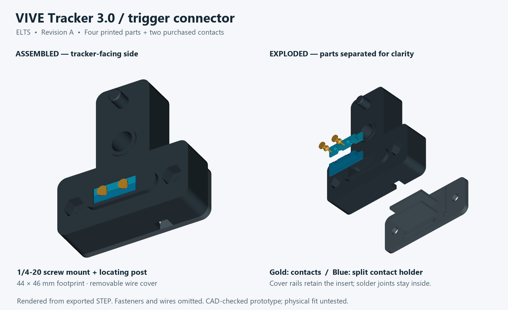
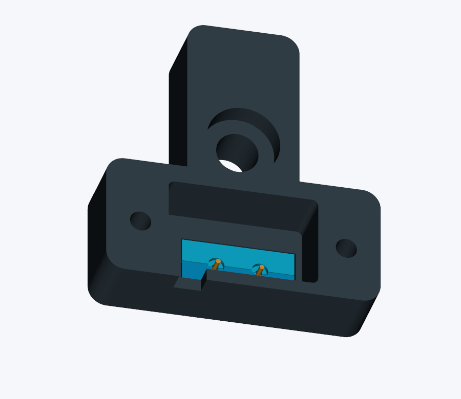

# VIVE Tracker 3.0 trigger connector — Revision A

An FDM-printable adapter with a recessed metal mounting screw, anti-rotation post, mechanically captured gold contacts, and a removable cover over the soldered wires. Designed for the **VIVE Tracker 3.0** and the exact contacts in [BUYING-LIST.md](BUYING-LIST.md).

**Status:** CAD geometry and print meshes checked against HTC's official model. Physical fit, printed strength, contact reliability, and electrical operation have not been tested. This is the connector only; a rifle mount is separate work.



## Open in Autodesk Fusion

1. Open `output/ELTS_VIVE_Tracker_3_Trigger_Connector_Rev_A.step` in Fusion using **File → Open → Open from my computer**, or upload it through the Data Panel.
2. Set document units to millimetres. The assembly contains four plastic parts and two reference metal contacts. The body footprint is **44 × 46 mm**.
3. Save the imported design in Fusion. These are editable STEP solids; the file does not contain a native Fusion sketch/feature timeline. Individual STEP parts are also provided.

Print the separate STL files below. Do not print the gold contact reference solids or the complete STEP assembly as one object. The STLs are already placed on their print beds; STEP parts retain their assembly coordinates.

## Print

Suggested starting profile: **PETG, 0.4 mm nozzle, 0.16 mm layers, 5 walls, 40% infill, 100% scale**. Use normal printer calibration and elephant-foot compensation. Do not scale the entire model to adjust a tight fit: that also changes contact spacing.

| File in `output/` | Quantity | Orientation and supports |
|---|---:|---|
| `mount_fit_coupon.stl` | 1 first | Flat face down; no supports. Checks the mounting seat and locating post. |
| `body.stl` | 1 | Flat rear face down; locating post upward. Use removable build-plate supports inside the open wire cavity and main screw counterbore. Inspect the slicer preview for supported internal roofs. |
| `insert_front.stl` | 1 | Broad flange down, as supplied; no supports. A small brim may help. |
| `insert_rear.stl` | 1 | Same as front insert. Keep the small stepped contact pockets clean. |
| `wire_cover.stl` | 1 | Flat outside face down; retaining rails upward; no supports. |

**Hand-fit the coupon without a screw.** The coupon is much thinner than the body; the selected 1/2-inch screw would protrude too far through it. The locating post should enter freely without forcing it. Then print the full body and check its fit before adding contacts. Remove all support material and burrs from mating surfaces.

## Assembly

1. Gather the hardware in the buying list. Keep the tracker disconnected while working. Insert the two **standard M3 nuts** into the hex pockets on the tracker-facing side of the body; seat them fully. They are ordinary nuts, not heated inserts.
2. Dry-fit both insert halves and the cover. Their flanges seat inside the body, and the cover's two tall rails support them from below. All parts should seat without screws pulling a misfit together.
3. Solder one 26 AWG flexible wire to each purchased contact **outside the printed parts**. Use short, narrow joints along the tails and insulate each separately with thin heat-shrink. Avoid heating the contact faces or contaminating their gold surfaces. The design exposes about **2.0 mm of tail** beyond its retaining shoulder. Keep the finished joint/sleeve below that shoulder and **no more than about 2.3 mm outside diameter**, so it clears the 2.6 mm relief.
4. Place the contacts in the stepped pockets of one insert half, with their flat gold heads facing the tracker. Close the other half around them. The lower contact shoulders rest on the small internal ledges; no glue is required. Load the joined insert through the body's open rear cavity, narrow stem first, until its flange reaches the internal shoulder.
5. Leave a small relaxed wire bend inside the cavity. Run the pair through a short protective sleeve at the cable exit. Feed a **2.5 mm-wide cable tie** through the two cover slots and around the sleeved pair. Tighten enough to carry a gentle cable pull without crushing insulation. Keep the tie head and wire slack clear of the insert-support rails and screw holes.
6. Install the cover with **two M3 × 12 mm button-head screws**, without washers. Tighten gently and evenly. Check that the contacts cannot retreat into the housing and that the cable tie carries the strain.
7. Insert the **1/4-20 × 1/2-inch button-head screw** through the main rear counterbore. Align the post and contacts, seat the adapter squarely against the tracker, and tighten gently by hand with the correct hex key. The nominal exposed screw length is **4.5 mm** above the metal-seat datum. Confirm this on the print before mounting; do not substitute a longer screw or force a screw that bottoms before the body seats. No washer is included in this stack.

The main screw clamps the body against the mount; the post resists rotation. The screw is recessed but is not captive when the adapter is removed. The closed cover retains the contact insert and protects the solder joints. This construction is not sealed against water.

**One-supplier hardware option:** the updated [DigiKey buying list](BUYING-LIST.md) substitutes a Keystone 21908 socket-head mounting screw and 29314 slotted cover screws. The mounting screw fits the existing recess and preserves the same 4.5 mm thread projection, but its taller head extends 2.55 mm below the body rather than being fully recessed. The cover screws use a slotted screwdriver. No printed-part changes or washers are needed. Follow the buying list's insulation instructions for its specifically selected heat-shrink.



## Contact orientation and wiring

Look directly at the adapter's **tracker-facing side**, with the locating post above the mounting hole:

```text
                     locating post
                          O
                     mounting hole
                          O

HTC pin position:     1   2   3   4   5   6
Installed contact:       GND     TRIGGER
```

This is the mating adapter view. Looking at the tracker's underside reverses left and right. Mark the ground wire before closing the cover.

```text
Tracker pin 4 / trigger ─── insulated wire ─── switch NO
Tracker pin 2 / ground  ─── insulated wire ─── switch COM
```

Use a normally open, electrically isolated momentary switch. Pressing it connects trigger to ground; releasing it opens the circuit. Leave every other tracker pin unconnected. No external voltage or added pull-up is needed. Do not solder onto the tracker.

Before mounting, use a meter to verify open circuit when released, continuity only between the two contacts when pressed, and stable behavior while gently moving the cable. Inspect the initial mounted fit for interference and stable contact. Then check actual SteamVR input and its mapping into ELTS; this connector does not implement that software integration or validate event timing. Preserve the project's software safety boundaries.

## Dimensions and evidence

All dimensions are millimetres unless explicitly stated otherwise. Coordinates use the mounting ring face as Z=0, +Z into the tracker, and +Y toward the locating post.

| Feature | Nominal design value |
|---|---|
| Ground / trigger X coordinates | -5.25 / +1.75 |
| Contact row Y / contact face Z | -16.969 / +2.595 |
| Locating post | Ø4.1; Y=14.001; tip Z=+4.5 |
| Body rear / tracker-facing broad surface | Z=-12 / -0.5 |
| Main screw bearing face | Z=-8.2; 12.7 mm under-head screw length |
| Wire cavity | 24 × 15 × 10 before insert and rails |
| Cover / cable opening | 2 mm cover; 4.4 × 3.5 mm opening |
| Insert-to-body allowance | 0.2 mm per side |

The contact height follows HTC's accessory drawing. The official STEP contains unloaded spring contacts: intentional overlap with the purchased targets occurs only at those plungers. The static model does not establish spring travel, force, or reliable electrical contact. Round target faces also differ from HTC's rectangular example pads; actual contact alignment remains a first-fit check.

`output/verification.json` records valid single solids, closed connected STL meshes, no plastic-to-tracker or plastic-to-plastic interference, clearance for the specified screw envelopes, and a valid six-solid assembly STEP round trip. A rendered inspection was also performed. These are digital checks only.

## Sources and changes

- [HTC developer guide v1.1](https://developer.vive.com/documents/850/HTC_Vive_Tracker_3.0_Developer_Guidelines_v1.1_06022021.pdf): printed pages 13–17 for pinout and accessory geometry.
- [HTC official Tracker 3.0 STEP archive](https://dl.vive.com/Tracker/3D_model/VIVE_Tracker_3.0_3D.zip): nominal enclosure and spring geometry.
- [Mill-Max contact drawing](https://www.mill-max.com/sites/default/files/external/assets/2017-12/Expanded%20Line%20of%20Mill-Max%20Target%20Connectors.pdf): page 5, flat-face 1946 solder-tail variant.

`parameters.json` stores the main dimensions and printer allowances. `build_connector.py` regenerates STEP/STL files using CadQuery 2.8.0. In a Python environment with CadQuery installed, run `python build_connector.py` from this folder. `validate_connector.py` additionally needs VTK and the official tracker STEP at `../official-model/VIVE_Tracker_3.0_3D_STP/VIVE_Tracker_3.0_3D.stp`. `render_connector.py` needs VTK and Pillow. Third-party reference models are linked rather than included in the connector ZIP.

Any later structural mounting changes require renewed fit checks and the corresponding ELTS geometry/calibration work. This adapter does not establish physical tracking, safety, study, or phase-gate readiness.
