# ELTS: simple user guide

Use this guide to run the **development** version of the administrator dashboard.

**Quick flow:** Open → ⚙ Settings → New participant → Begin walkthrough → participant pulls the trigger once → scenarios and breaks run automatically → form.

> This version uses synthetic inputs. It is for software rehearsal, not physical equipment validation or study-ready operation. Screenshots show the current interface with fictional demonstration data; the camera feed is not connected in these examples. Click any image on GitHub to enlarge it.

The current interface uses a dark Texas Tech theme. Scarlet marks primary
actions, active selections and keyboard focus; green, amber and red retain
their labeled success, warning and error meanings. Turn on **Reduce interface
motion** in Settings if you prefer immediate state changes without transitions.

[Open the software](#1-open-the-software) · [Set up tests](#2-arrange-tests-and-set-the-times) · [Add a participant](#3-create-the-participant-recording) · [Walkthrough](#4-begin-the-participant-walkthrough) · [Run tests](#5-start-the-study) · [Breaks](#7-breaks-and-the-next-test) · [Find data](#8-finish-and-find-the-saved-data)

## 1. Open the software

1. On Windows x64, download and extract the [Windows rehearsal ZIP](https://github.com/AceeEcho/DESS-ELTS-Research-Software/releases/download/development-rehearsal-2026-11-18/ELTS-Development-Rehearsal-20261118.zip). Double-click **PREPARE-REHEARSAL.cmd** once to create fictional participant **0** and launch ELTS. Later launches use **START-ELTS.cmd**.
2. If you installed from source, double-click **START-ELTS.cmd** in the source folder. Allow the first setup and build to finish, including any Unity sign-in or license prompts. [Source installation](../../README.md#install-from-source)
3. Two windows open. Use the **administrator dashboard** in your browser to run the session. The participant uses the **participant game**.

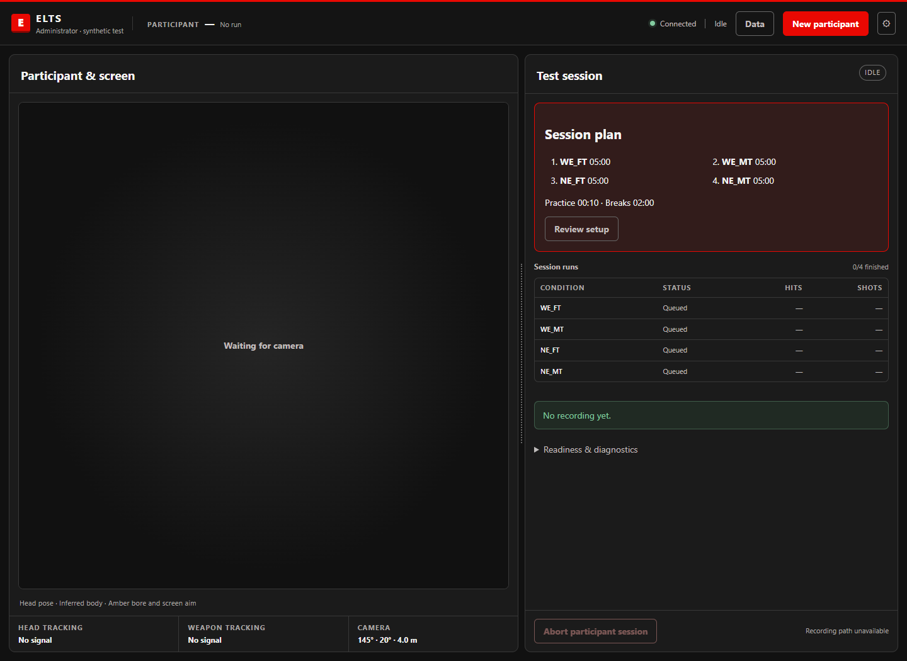

| Where to look | What to do there |
| --- | --- |
| **⚙ Settings**, top right | Arrange tests, adjust times and change window settings. |
| **New participant**, top right | Choose a saved numeric ID and begin a recording. |
| **Test session**, right pane | Arm, pause, resume, stop and manage breaks. The save status shows when a recording has reached disk. |
| **Outside view**, left pane | Watch the camera view. Drag to orbit; use the mouse wheel to zoom. |
| **Data**, top right | View participant profiles, saved sessions and exports. |

The thin divider between the panes can be dragged to change their widths. Gray buttons become available when their action is allowed; scarlet buttons and borders identify the active next step.

## 2. Arrange tests and set the times

Before creating a participant, click **Review setup** or **⚙ Settings**.

**Set the order:** grab the six-dot handle beside a condition and drag it up or down. Release it to save the order. Press Escape to cancel a drag. You can also focus a handle and use the Up/Down arrow keys. The order locks once a participant session starts.

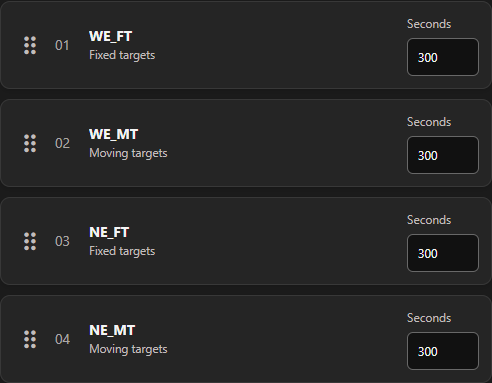

Set the time in seconds beside each test in **Session plan**.

- **Test durations:** enter seconds for each test. Click outside the field or press Tab, then wait for **Saved**. The default is 300 seconds (5 minutes).
- **Practice** and **Every break:** enter the durations and press Tab or Enter to save. The same break duration applies after every test. The study plan calls for 120-second (two-minute) breaks, as shown below.

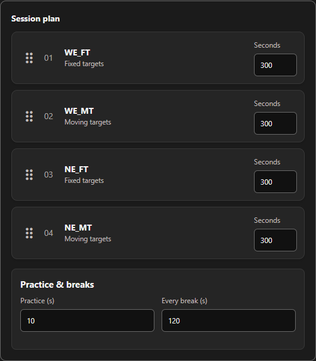

To reuse a setup, enter a **Preset name** under **Saved setups** and click **Save setup** after applying your changes. Later, select it and click **Load** before creating a participant. Presets stay in that browser; load them again after restarting the app.

Close Settings using **×**. You can return to Settings during a session for display controls or permitted timing edits. Pause a running test before changing its duration.

## 3. Create the participant recording

Click **New participant** and choose the saved **Participant ID** from the list. ELTS shows whether its calibration is ready. Open **Calibration sources** to check the profile and room revisions. If the ID is missing, add it in the packaged rehearsal with **ADD-REHEARSAL-ID.cmd**. From source, open **START-CALIBRATION.cmd**, choose **Save calibration**, and use the digit picker or **Use next unused ID**. Click **Create recording** and wait for preparation to finish.

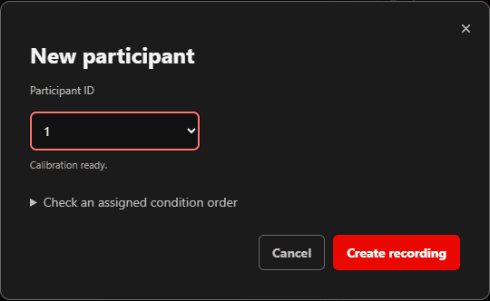

If you have an assignment sheet, open **Check an assigned condition order** and paste the row containing the ID and four codes. ELTS compares the row with Settings. Correct a mismatch or choose a reason to keep the configured order. The recording retains both orders.

The participant code, visit and applied settings are saved with the recording. Creating a recording does not start a shooting test.

## 4. Begin the participant walkthrough

Click **Begin walkthrough**. Follow the setup checks, separate head and
gun fixture reviews, and aiming/firing/reloading instructions. Each action waits
for its actual input or operator confirmation. Calibration remains synthetic.

Start practice when ready. Practice is unscored; pause, restart and early finish
remain available. The simulated ELTS demonstration follows practice, then the
study overview. All 39 narration clips are bundled. See the
[walkthrough guide](../developer/modules/participant-tutorial.md) for pacing and controls.

## 5. Start the study

With the walkthrough, the first test arms after the readiness message. The participant uses **Shoot to begin** once. The later tests start automatically after their breaks and transition announcements.

**Manual mode.** To skip the walkthrough, click **Manual mode · skip walkthrough** instead of **Begin walkthrough** and confirm. The synthetic calibration fixture is saved for you and practice is skipped. This cannot be undone for that participant, and nothing arms or starts on its own. Check the condition and duration in **Current task** and click **ARM TEST** when the participant is ready.

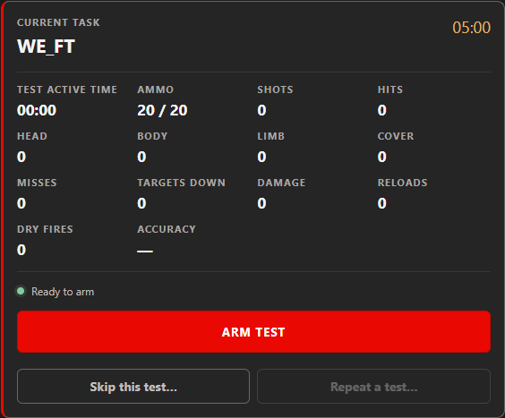

The participant window then says **Shoot to begin**. The participant clicks and releases, or pulls the gun trigger if one is set up, to start the test; that starting shot is not counted. Before they start, **DISARM TEST** cancels arming.

During the test, the participant aims with the mouse and clicks/releases (or pulls a configured gun trigger) to fire one round. See [VIVE gun trigger](../../README.md#-install-and-run) for setting up the trigger. The magazine holds 20 rounds and does not reload automatically; press R to reload. W/S moves forward/back, A/D moves left/right, Q/E moves down/up, and Home resets the virtual pose. The synthetic targets have three health: head/body/limb hits deal 3/2/1 damage. The dashboard shows region hits, cover hits, misses, and targets down.

To resize the participant window, drag its edges. F11 or Alt+Enter toggles fullscreen; Escape returns to the previous window size. Switching windows does **not** pause the timer.

## 6. Pause, stop or abort a session

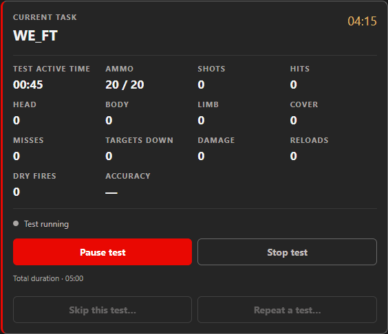

- **Pause test:** holds the timer and targets. Click **Resume test** to continue the same test.
- **Stop test:** asks you to confirm an early finish. Results so far are saved as **Stopped early**; that attempt cannot resume.

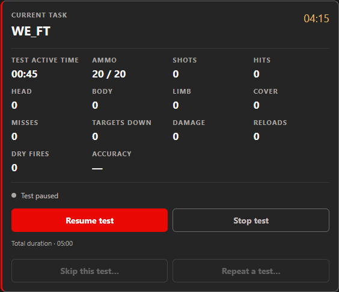

For exceptions, **Skip this test…** skips a ready, disarmed test with a reason. **Repeat a test…** creates another attempt with a reason and preserves the earlier results. To end the entire visit early, choose **Abort participant session** and click **Abort session** in the confirmation. ELTS closes the recording and cancels the remaining tests.

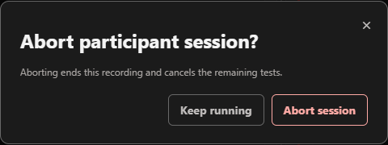

## 7. Breaks and the next test

With the walkthrough, each completed test saves its checkpoint before the break starts automatically. The next test starts after the countdown and transition announcement when tracking is valid. **Skip break** and **Skip this test…** remain available during their applicable phases. The final break leads to the post-study form.

For a manual session, use these controls after each test ends:

1. Wait for the test to finish saving.
2. Click **Start break** when you want the countdown to begin. Waiting before this click does not use any break time.

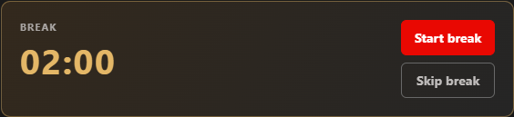

3. Wait for the countdown, or click **Skip break** to finish it early. You can also skip a break before starting its timer.
4. When the next test is ready, click **ARM TEST** yourself. The participant again uses **Shoot to begin**.

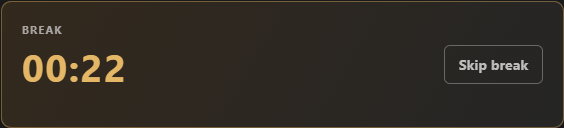

After the final test, complete or skip its break to close the participant recording.

## 8. Finish and find the saved data

Click the small **Data** button at the top. It switches the dashboard to the participant collection. Click **Test administration** to return; switching views does not pause an active test.

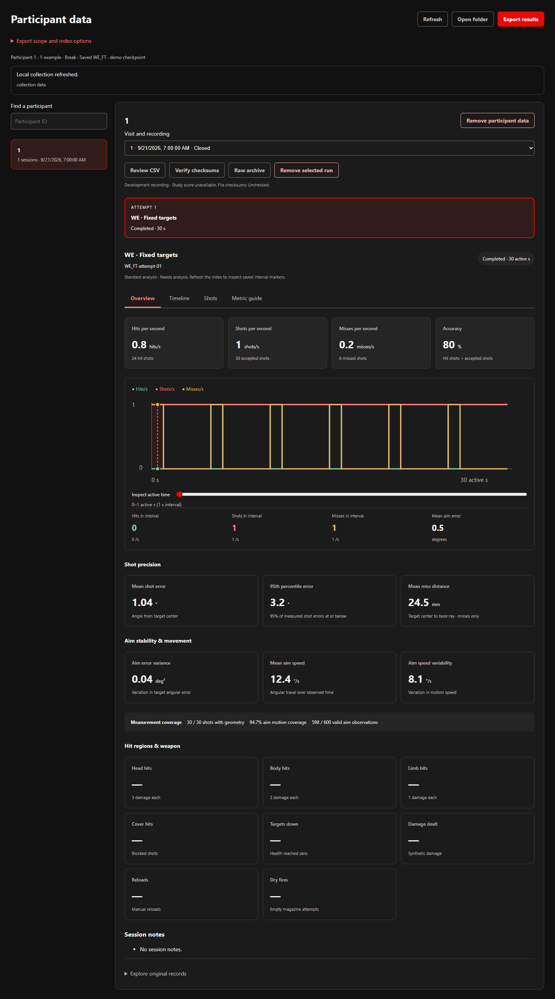

1. Find a participant by ID in the left panel. Reusing the same participant ID groups their sessions under one unique profile.
2. Choose a recording under its visit, then an attempt. **Overview**, **Timeline**, **Shots** and **Metric guide** show results for that attempt. Expand **Explore original records** to page through the saved records.
3. Click **Refresh** to index changed recordings. **Verify checksums** checks the selected closed recording against its saved closure summary and displays the result and time. **Rebuild index**, under **Export scope and index options**, rereads every recording and preserves exclusions.
4. Expand **Standard 300-second analysis** to see the recording status and the visit summary. Each attempt shows its own reason. **Excluded** identifies a known issue such as an interrupted recording or flexible timing. **Needs analysis** means the offline analysis still needs to validate the raw files.

- **Export results** creates an Excel workbook. Under **Export scope and index options**, choose everyone, one participant, one visit or a UTC recording modification date range. **Preview row counts** shows the size before export. **Results**, **Shots** and **Timeline** contain the observations. **Metric guide** explains the columns. **Recordings** lists the included recordings and checksum status. **Handoff** provides one row per attempt for linking external recordings.
- **Raw archive** creates a ZIP of the selected closed recording. **Recovery copy** saves the available files from an interrupted recording after acquisition stops.
- **Download export:** downloads the prepared file through your browser. Export copies also remain in the data folder's **exports** directory.
- **Open folder** opens the data folder shown in the viewer. Its default name is **collection data**. The station home and machine configuration determine its location.

The data folder and **collection.sqlite** are created when the administrator starts, even before the first participant. Raw data is written continuously. Each finished or skipped test saves a checkpoint and updates its results; the final recording closure updates them again. Exports contain the results through the latest save or refresh. Wait for saving to finish before closing ELTS.

Storage and export failures appear in the Data view and flag its button. If updating results fails, the original raw files remain available; **Refresh** retries. Browser privacy settings that block saved layout preferences do not disable the controls.

The collection is local to this machine and excluded from Git. A standalone player outside the project saves beside its executable when no station home is configured. The packaged launcher selects a durable rehearsal station under the current Windows account. See [data storage and recovery](../developer/modules/data-collection.md) for the database layout and limits.

## Start a fresh dataset

Finish or abort the active session and close any other ELTS player using this station's data. Open **Settings** and click the red **Remove all participant data…** button at the bottom. Type `CONFIRM` exactly and click **Remove**. Wait for the station to report that removal is complete before starting a new participant.

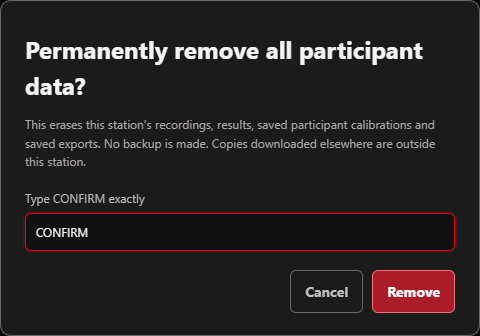

This permanently deletes the station's original recordings, participant calibrations, calibration drafts, results, index exclusions and managed exports. ELTS creates an empty index without making a backup. Copies previously downloaded or exported outside the station stay wherever you saved them. The station's shared room setup is preserved.

## If something does not look right

| What you see | What to do |
| --- | --- |
| **Offline** at the top | Check that the participant application is still running, then refresh the dashboard. |
| **ARM TEST** is disabled | Finish calibration/practice or the break, and wait for saving to complete. |
| Order cannot be changed | Finish the current participant session; arrange the next participant's order afterward. |
| A recording is incomplete or a save fails | Read the displayed error and keep its files. Do not treat it as a finalized recording. |
| Startup stops with an error | Read the startup window and use the [setup troubleshooting guide](troubleshooting.md#install-and-startup). |
| A device, save, export, or analysis step fails | Use the [session troubleshooting guide](troubleshooting.md). |

For detailed behavior, see the [administrator reference](../developer/modules/operator-dashboard.md).

### Move a station or restore a copy

Set `ELTS_STATION_HOME` to an absolute directory in the environment used to start both ELTS and Calibration. Both applications then use that directory for participant storage across upgrades. The default recording folder is `collection data` and the private calibration folder is `Calibration Environment/profiles`. Existing installations can continue using their current directories.

Close the player and calibration window before making an offline copy. From the project directory, preview the source and destination, then repeat with `--copy` to perform it. Use a new destination for each copy. If the station uses a custom `dataRoot`, supply its relative path with `--data-root`.

```powershell
py -3 tools/data/station_copy.py "D:/ELTS Station" "E:/ELTS Archive/November"
py -3 tools/data/station_copy.py "D:/ELTS Station" "E:/ELTS Archive/November" --copy
```

To restore, use the archive as the source and a new station folder as the destination. Start both applications with `ELTS_STATION_HOME` pointing to the restored folder. Open **Data**, click **Refresh** and check that the expected participants and visits appear and previously excluded recordings stay out of the list. To roll back an upgrade, point both applications back at the previous station home. Copies are private and are created only on request. The permanent removal control operates on the current station.
