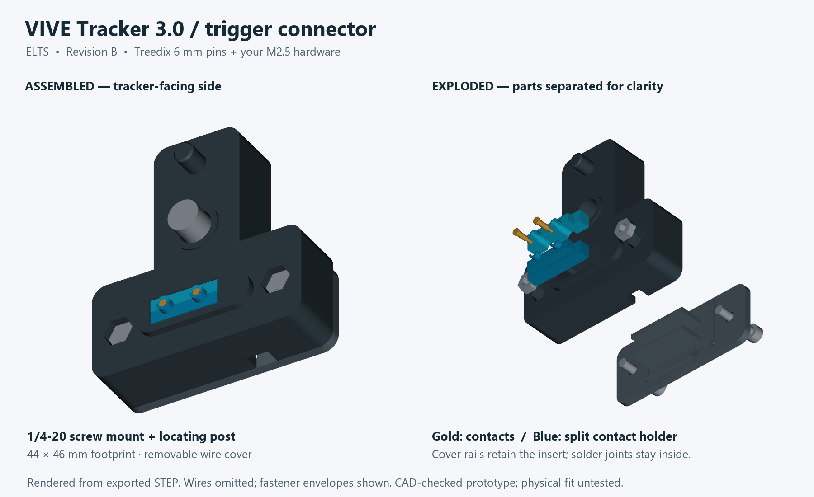
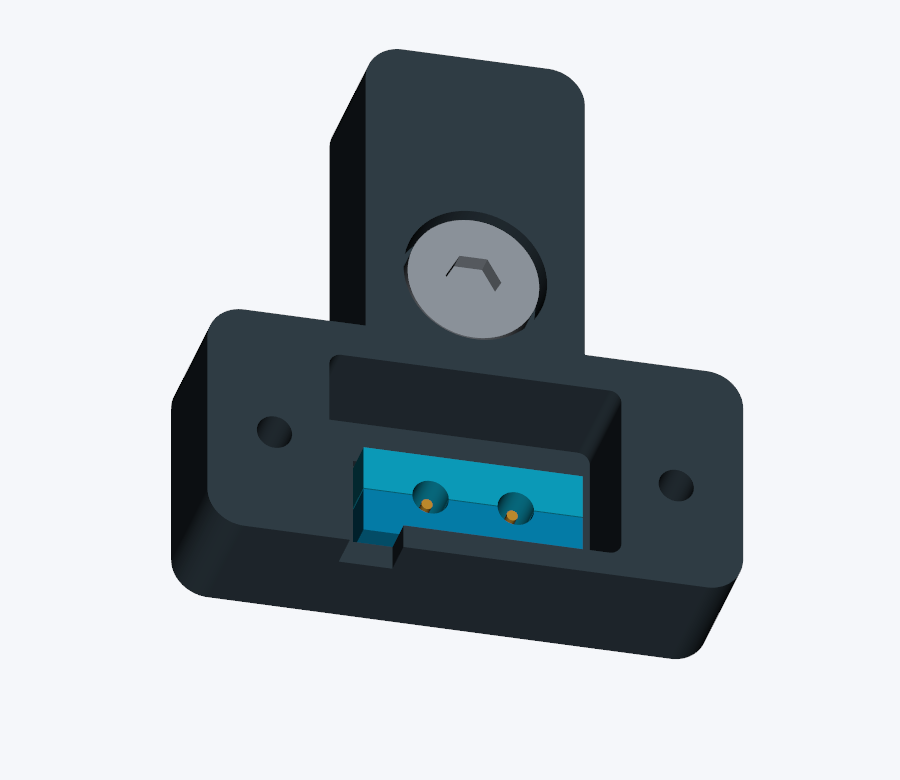

# VIVE Tracker 3.0 trigger connector — Revision B

Printable connector revised for **Treedix 6 mm pins (Amazon B0BFD27HSR)** and the **M2.5 hardware in your HAPRIC kit**. The mounting screw is a 1/4-20 × 1/2-inch Allen-drive button head. Revision A is preserved separately.

**Prototype:** digital geometry checks only. Physical fit, electrical reliability, solderability, printed strength, and tracking have not been tested. This is the electrical connector housing; a rifle mount is separate work.



## Open and print

Open `output/ELTS_VIVE_Tracker_3_Trigger_Connector_Rev_B.step` in Autodesk Fusion, using File → Open → Open from my computer. Units are millimetres. It contains four printable solids, two contact references, and five fastener references. The solids are editable; there is no native Fusion feature timeline.

Print **only** `body.stl`, `insert_front.stl`, `insert_rear.stl`, and `wire_cover.stl`, one each. STLs are on the bed; STEP files retain assembly coordinates. Start with `mount_fit_coupon.stl` and **hand-fit it without a screw**: the selected screw is too long for this thin coupon.

Suggested initial profile: PETG, 0.4 mm nozzle, 0.16 mm layers, five walls, 40% infill, 100% scale. Body: rear face down with removable supports in the open wire cavity and main screw recess. Cover: outer face down, rails up. Inserts: flange down as supplied; inspect the small lips and use a brim if needed. Check the slicer before printing. Remove supports and burrs; never scale the whole part to fix hole fit because contact spacing would change.

## Hardware

| Item | Quantity | Source |
|---|---:|---|
| Treedix 6 mm spring pin, 2 mm base | 2 | [Your selected 30-pack](https://www.amazon.com/dp/B0BFD27HSR?th=1), **6 mm option** |
| M2.5 × 12 socket-head screw | 2 | HAPRIC kit, Photo 2 |
| M2.5 ordinary hex nut | 2 | HAPRIC kit, Photo 2 |
| 1/4-20 UNC × 1/2-inch button-head Allen screw | 1 | [SG TZH on Amazon](https://www.amazon.com/dp/B0B81Y8K3V) |
| Flexible insulated wire | 2 leads | 26 AWG suggested |
| Thin insulation, exit sleeve, 2.5 mm cable tie | As needed | Existing supplies or separately sourced |

**No washers are used in either screw stack.** Both photographed kits contain metric fasteners; neither supplies the main 1/4-20 UNC screw. Kit head/nut dimensions are nominal assumptions, not measurements extracted from the photos. Confirm the actual nuts seat fully and screw heads clear before assembly.

The Amazon main-screw drawing shows 10.8 mm head diameter, 3.2 mm head height, and a 3.97 mm hex socket (approximately 5/32 inch); an Allen key is included in the listing. Use the **1/4-20 × 1/2-inch** option. The listing rounds the 12.7 mm nominal under-head length to 13 mm. Measure actual projection through the printed body before mounting.

## Pin orientation — read before soldering

The Treedix pins are installed **backward relative to their usual spring-contact use**: the **fixed, flat 2 mm base faces the tracker**. The 1.5 mm stationary barrel and unused moving plunger point into the enclosure. The tracker's own spring contacts press on the fixed gold bases. This avoids mating two small moving tips. Verify continuity between each base and stationary barrel on the actual pins before soldering; the seller provides no detailed internal construction specification.

The split insert captures each base between a lower shoulder and an upper lip. A 1.6 mm window exposes the gold target. The pin has 0.08 mm nominal axial allowance; its target height is 2.515–2.595 mm above the mounting ring. The small windows are centered on HTC's STEP spring axes, not the center of its larger example accessory pads.

Solder to the **stationary barrel**, never the moving tip or gold mating base. The relief exposes approximately **1.785 mm** of stationary barrel above its plunger end. Keep the solder joint and insulation within a **2.6 mm diameter envelope**, inside the 3 mm relief. Keep the unused plunger free of solder, adhesive, and insulation. Do this outside the plastic, with a short heating time; verify continuity afterward. Solderability and this packaging method require a bench trial with one spare pin before committing both contacts.

## Assembly

1. Keep the tracker disconnected. Hand-fit the coupon, then the bare full body. Do not use the screw to force a tight locating post or mismatched print into place.
2. Seat the two M2.5 nuts fully in the hex pockets on the tracker-facing side. Dry-fit the inserts and cover. The cover rails support the insert flanges from below.
3. Check each pin's base-to-barrel continuity. Pre-solder a flexible lead to each stationary barrel and insulate the joint within the dimensions above. Leave the fixed gold bases clean. Mark the ground lead.
4. Put the pins into one insert half, **flat bases toward the tracker, moving tips toward the wire cavity**. Close the second half around them. Feed the assembled insert through the body's rear opening until its flange reaches the shoulder.
5. Route wires down alongside the unused plungers, away from the support rails. Leave a relaxed bend. Sleeve the pair where it exits; thread a 2.5 mm cable tie through the cover's two slots and around the sleeve. The tie should carry a gentle cable pull without crushing the wires.
6. Install the cover with the two **M2.5 × 12 screws**, no washers. Tighten gently. Nominally each screw fully engages the 2 mm nut and projects 0.1 mm beyond it; it remains below the tracker-facing surface. Confirm this on your actual hardware.
7. Insert the **1/4-20 × 1/2-inch button-head screw** from the rear. Its nominal exposed thread is **4.5 mm** above the mounting ring, and its head is recessed 0.6 mm. Measure the print/screw stack before mounting. Align the post and contacts, seat squarely, and tighten gently by hand. Stop if the screw bottoms before the housing seats. Do not substitute a longer screw.

The main screw is removable, not captive. The enclosure is not waterproof. Use the revised body, inserts, and cover together; do not mix Revision A and B parts.



## Wiring and first fit

Look directly at the adapter's **tracker-facing side**, locating post above mounting hole. HTC contact positions run 1 through 6 from left to right: install **ground at 2** (X=-5.25) and **trigger at 4** (X=+1.75). Looking at the tracker's underside reverses left and right.

```text
Tracker pin 4 / trigger ---- insulated lead ---- switch NO
Tracker pin 2 / ground  ---- insulated lead ---- switch COM
```

Use an isolated normally open momentary switch; leave all other tracker contacts disconnected. No external voltage or pull-up is required. Do not solder to the tracker. With the connector off the tracker, verify open circuit when released, continuity when pressed, and stable continuity while gently moving the cable. Then inspect mounted alignment and check actual SteamVR press/release behavior and ELTS input mapping. Those hardware checks remain outstanding.

## Geometry and verification

| Feature | Nominal value, mm |
|---|---|
| Footprint | 44 × 46 |
| Datum | Mounting ring face Z=0; +Z into tracker; +Y toward locating post |
| Contact row Y | -16.520189, from HTC STEP spring axes |
| Reference accessory pad row Y | -16.969, from HTC drawing |
| Target face Z | 2.515 seated, 2.595 maximum with axial clearance |
| Locator | Ø4.1, Y=14.001, tip Z=4.5 |
| Body rear / broad front face | Z=-12 / -0.5 |
| Main screw bearing / pocket | Z=-8.2 / Ø11.8 |
| Cover clearance holes / nut pockets | Ø2.9 / 5.3 across flats |
| Insert body clearance | 0.2 per side |

The Treedix nominal drawing gives 6 mm overall length, 2 mm × 0.5 mm base, 1.5 mm × 3.5 mm barrel, and 2 mm exposed plunger. Exposed length is **not** a rated spring stroke. This design does not use the Treedix spring travel. HTC's unloaded plungers overlap the fixed targets in the reference model; actual spring travel and force remain unverified.

`output/verification.json` records STEP validity, closed connected print meshes, plastic clearance against HTC's model, pairwise plastic clearance, fastener envelope clearance, and an eleven-solid assembly round trip. Intentional contact overlap is confined to the intended HTC plungers. These checks do not prove print tolerances, contact pressure, solder-joint durability, or electrical operation.

All dimensions are in `parameters.json`. Regenerate with `python build_connector.py` using CadQuery 2.8.0, then `python validate_connector.py` and `python render_connector.py` (VTK/Pillow required). Validation uses HTC's reference at `../official-model/VIVE_Tracker_3.0_3D_STP/VIVE_Tracker_3.0_3D.stp`. The third-party model is not bundled in the connector ZIP.

Sources: [HTC developer guide v1.1](https://developer.vive.com/documents/850/HTC_Vive_Tracker_3.0_Developer_Guidelines_v1.1_06022021.pdf), [official tracker STEP archive](https://dl.vive.com/Tracker/3D_model/VIVE_Tracker_3.0_3D.zip), and the product links above (seller drawings visually checked 2026-10-19). Hardware photos establish kit labels and sizes only.

Preserve the [ELTS software safety boundaries](../../../docs/safety/README.md). This connector does not establish physical tracking, calibration, safety, study, or phase-gate readiness.
